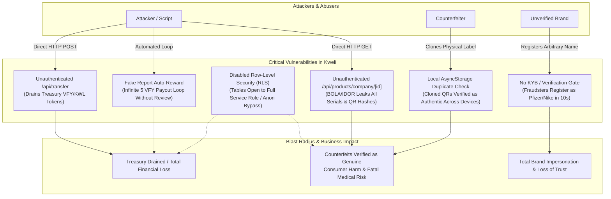
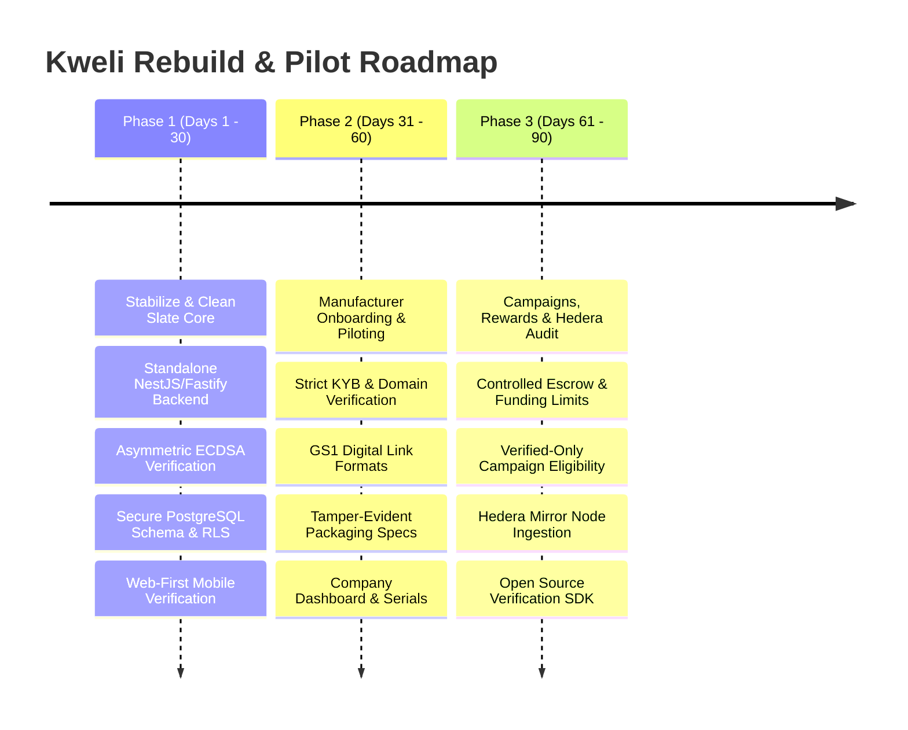

# KWELI — EXECUTIVE AUDIT SUMMARY

**Document ID:** KW-AUDIT-01  
**Audit Date:** October 2026  
**Auditor:** Independent Systems & Security Architecture Review  
**Subject:** Kweli Product Authentication Ecosystem & Monorepo  
**Target Git Revision:** Commit `fb3b60dad4c7ff382096e19e9e7e5145347ac5f1` ("Saving the commit incase a rollback is needed")  
**Remote Origin:** `https://github.com/Devnuelx/Kweli.git` (Branch: `main`)  

---

## 1. Executive Summary & Purpose

Kweli was originated as a hackathon project (*Hedera Africa Hackathon 2025*) with the mission of eliminating counterfeit pharmaceuticals, consumer goods, and industrial products across Sub-Saharan Africa. The platform aspires to evolve into an open, commercial product-authentication ecosystem serving brand manufacturers, consumers, retail distributors, and developers, powered by verifiable credentials, rewards, and auditable distributed-ledger logging.

This audit is a comprehensive, read-only architectural, security, code, and operational evaluation. **No production data, databases, infrastructure, or code were altered during this audit.**

### Primary Finding & Verdict

> [!CAUTION]
> **The current codebase cannot be deployed to production, piloted with real manufacturers, or open-sourced in its current state.**  
> While the UI shell, branding vision, and hackathon presentation are compelling, the underlying implementation suffers from **critical security vulnerabilities, broken duplicate-detection assumptions, architectural fragmentation across three contradictory codebases, severe data-model mismatches, and zero automated test coverage.**

The system currently proves **only** that a database record matching a random string exists. It **does not prove** physical product authenticity, does not protect against cloning attacks, stores Hedera private keys in plaintext, leaves treasury token transfer endpoints unauthenticated, disables database Row Level Security (RLS), and has never verified signatures on Hedera or anywhere else.

---

## 2. High-Level Health & Readiness Scorecard

| Domain | Rating | Current State | Readiness for Commercial Pilot |
| :--- | :---: | :--- | :---: |
| **Authentication & Anti-Counterfeit** | **CRITICAL FAIL** | Random UUID database lookup; clone attacks pass as authentic; duplicate detection in mobile app is stored in local phone AsyncStorage; AI verification is aesthetic heuristic. | **Not Ready** |
| **API & Backend Architecture** | **CRITICAL FAIL** | Split between Next.js API routes (`apps/web`) and an uncommitted NestJS rewrite (`apps/api`); unauthenticated transfer/mint endpoints; broken IDOR object permissions. | **Not Ready** |
| **Security & Privacy** | **CRITICAL FAIL** | RLS disabled across primary tables; unauthenticated treasury draining endpoint (`/api/transfer`); unencrypted private keys in DB; bypassable billing upgrade. | **Not Ready** |
| **Data Integrity & Schema** | **POOR** | Divergence across V1 schema (`products.qr_hash`), V2 schema (`product_units.serial_code`), and Prisma schema; missing columns causing runtime 500 crashes. | **Not Ready** |
| **Campaigns & Rewards** | **HIGH RISK** | Instant-win RNG lacks database locks (race conditions); campaigns require no company funding/escrow; token farming loops in fake reporting and scanning. | **Not Ready** |
| **Mobile & UX Experience** | **BROKEN** | Mobile app calls non-existent endpoints (`/products/scan` missing `/api`, `/api/user/sync`, `/api/user/wallet`); airtime/data redemption is hardcoded "Coming Soon". | **Not Ready** |
| **Hedera Ledger Integration** | **INCOMPLETE / MISREPRESENTED** | Write-only audit sink; messages are never read or verified; HTS token has infinite supply (contrary to claim); bulk import causes serverless timeouts. | **Redesign Required** |
| **Testing & CI/CD** | **ZERO COVERAGE** | Exactly 0 unit tests, 0 integration tests, 0 end-to-end tests; broken workspace symlinks prevent local build/lint execution. | **Not Ready** |
| **Open-Source Readiness** | **NOT READY** | Proprietary Supabase/Vercel coupling; lack of standalone verification package; risk of exposing historical secrets. | **Redesign Required** |

---

## 3. Top Critical Findings Summary

Below is an overview of the most critical vulnerabilities and architectural defects identified during the audit:



### 1. SEC-01 (Critical): Unauthenticated Treasury Token Drain Endpoint
- **Affected File:** `apps/web/app/api/transfer/route.js`
- **Issue:** The endpoint accepts `{ receiverId, amount }` via an unauthenticated POST request and executes a real Hedera Token Service (HTS) transfer from the treasury operator account to the recipient.
- **Impact:** Anyone with internet access can drain the entire token treasury with a single `curl` command.

### 2. AUTH-01 (Critical): Digital Duplicate Verification Fallacy
- **Affected Files:** `apps/web/app/api/scan/[serial]/route.js`, `apps/mobile/app/(tabs)/index.tsx`, `apps/mobile/services/storage.ts`
- **Issue:** In the mobile app, duplicate checking is performed against `AsyncStorage` on the local smartphone. In the web scanner, duplicate detection merely checks `scan_count === 0`.
- **Impact:** Cloned QR codes on counterfeit packages pass as genuine for the first scan. Subsequent scans advise consumers: *"If you just scanned this a moment ago, the product is authentic,"* creating an easy deception window for counterfeiters.

### 3. SEC-02 (Critical): Disabled Supabase Row Level Security (RLS)
- **Affected File:** `apps/web/database/migrations/004_fix_rls_policies.sql`
- **Issue:** Migration script explicitly disabled RLS on `companies`, `products`, and `design_templates`.
- **Impact:** Any database client with access to public keys or misconfigured client-side queries can read and manipulate core company and product records.

### 4. DATA-01 (Critical): Severe Schema & Route Mismatch Crashing Core Features
- **Affected Files:** `apps/web/app/api/products/stats/route.js`, `apps/web/app/api/campaigns/enter/route.js`
- **Issue:** Code queries column names that do not exist in the database (e.g. `scanned_at` instead of `created_at` in `scan_events`; `is_winner`, `quantity`, `name` instead of `won`, `max_winners`, `tier_name` in `campaign_prizes` and `campaign_entries`).
- **Impact:** Dashboard statistics and campaign entry endpoints throw runtime HTTP 500 errors.

### 5. SEC-03 (Critical): Plaintext Storage of Hedera Private Keys
- **Affected File:** `apps/web/database/migrations/005_token_transactions.sql`
- **Issue:** Table `users` contains unencrypted text columns `hedera_account_id` and `hedera_private_key`.
- **Impact:** A database breach immediately exposes user custodial blockchain wallets.

### 6. ARCH-01 (Critical): Disconnected Monorepo Architecture
- **Affected Packages:** `apps/web` vs `apps/api` vs `apps/mobile`
- **Issue:** `apps/api` contains an uncommitted NestJS rewrite with Prisma that is completely ignored by root workspace scripts and mobile clients. The mobile client targets `https://kweli-web.vercel.app` (Next.js), but calls missing routes (`/products/scan/...` without `/api`, `/api/user/sync`, `/api/user/wallet/...`).
- **Impact:** The mobile application cannot verify products or load wallet data against the deployed backend.

### 7. HED-01 (High): Hedera Integration is a Write-Only Sink
- **Affected Files:** `apps/web/lib/hedera/hcs.ts`, `apps/web/lib/hedera/createRewardToken.ts`
- **Issue:** HCS messages are submitted fire-and-forget; the application **never reads, queries, or validates** messages from Hedera. The HTS token was created with `Infinite` supply (`KWL`), contradicting documentation claiming a 100M fixed supply of `VFY`.
- **Impact:** Hedera adds transaction latency and failure points without providing any actual decentralized trust or verification guarantees.

---

## 4. Key Architectural Insights: What Kweli Can and Cannot Prove

```
+--------------------------------------------------------------------------+
|                        WHAT KWELI CAN CURRENTLY PROVE                    |
+--------------------------------------------------------------------------+
| [x] A specific random string (UUID) exists in a PostgreSQL table.        |
| [x] That string has been queried N times via HTTP GET/POST.              |
| [x] A JSON payload was written to a Hedera Consensus topic.             |
+--------------------------------------------------------------------------+
|                      WHAT KWELI CANNOT CURRENTLY PROVE                   |
+--------------------------------------------------------------------------+
| [!] That the physical item inside the box was made by the claimed brand. |
| [!] That the QR code label was printed by an authorized manufacturer.    |
| [!] That the QR code label has not been photocopied or cloned.           |
| [!] That the person scanning the item is holding a genuine product.      |
| [!] That the image analyzed by AI is not a deceptive counterfeit.        |
| [!] That the registered company actually owns the trademark or brand.    |
+--------------------------------------------------------------------------+
```

---

## 5. Strategic Recommendations & Rebuild Decision Matrix

### Decision: Rebuild vs. Refactor

A pure refactor of the existing codebase is **not recommended** because the underlying security, database, authentication, and verification models are fundamentally flawed and intertwined with legacy hackathon code. 

Instead, a **phased architectural rebuild (Clean Slate Pilot Core)** is recommended:



### Component Disposition Summary

| Subsystem | Current State | Recommendation | Primary Action |
| :--- | :---: | :---: | :--- |
| **Consumer Web Verification** | Partial / Fragile | **Keep & Refactor** | Retain Next.js scanner UI (`page.tsx`), wire strictly to verified backend. |
| **Consumer Expo Mobile App** | Broken / Desynced | **Refactor / Postpone** | De-prioritize for Pilot 1 in favor of universal web browser verification (QR scan). |
| **Manufacturer Dashboard** | Partial / Buggy | **Refactor** | Fix data ID mismatches in downloads; add true tenant isolation and role permissions. |
| **Backend API (`apps/web/app/api`)** | Broken / Vulnerable | **Replace** | Retire Next.js route handlers as backend; promote and complete dedicated API (`apps/api`). |
| **Database Schema** | Fragmented / Broken | **Replace** | Consolidate onto a single migration-managed PostgreSQL schema with enforced RLS. |
| **Hedera Integration** | Write-only / Misused | **Simplify & Make Optional** | Decouple verification from ledger; use Hedera as an asynchronous, verifiable anchor. |
| **AI Vision Verification** | Flawed / Dangerous | **Retire from Core Auth** | Remove from authenticity certification; demote to customer support / defect reporting. |
| **Token Economy & Transfer** | Unsecured / Abusable | **Redesign** | Remove open transfer endpoints; enforce escrow budgets and off-chain point reconciliation. |

---

## 6. Document Roadmap

The complete findings, reproduction steps, technical evidence, and actionable transition plans are detailed across the following audit volumes:

- [`02-repository-and-architecture-inventory.md`](file:///c:/Users/user/Desktop/Kweli/02-repository-and-architecture-inventory.md) — Source tree, packages, dependencies, build/test health, and dead code inventory.
- [`03-product-and-user-journey-audit.md`](file:///c:/Users/user/Desktop/Kweli/03-product-and-user-journey-audit.md) — Step-by-step tracing of consumer, manufacturer, and developer journeys with failure modes.
- [`04-authentication-threat-model.md`](file:///c:/Users/user/Desktop/Kweli/04-authentication-threat-model.md) — Deep cryptographic analysis, threat matrix, clone attacks, and verification limits.
- [`05-backend-api-and-data-audit.md`](file:///c:/Users/user/Desktop/Kweli/05-backend-api-and-data-audit.md) — Route-by-route API inventory, database schema divergence, RLS flaws, and performance.
- [`06-campaigns-rewards-and-analytics-audit.md`](file:///c:/Users/user/Desktop/Kweli/06-campaigns-rewards-and-analytics-audit.md) — Reward lifecycle, financial exploit vectors, campaign race conditions, and analytics metrics.
- [`07-open-source-and-interoperability-audit.md`](file:///c:/Users/user/Desktop/Kweli/07-open-source-and-interoperability-audit.md) — Standards assessment (GS1, W3C VC/DID), public/private boundaries, and licensing.
- [`08-security-and-privacy-audit.md`](file:///c:/Users/user/Desktop/Kweli/08-security-and-privacy-audit.md) — Vulnerability register, IDORs, OWASP Top 10 risks, and data privacy assessment.
- [`09-hedera-and-infrastructure-assessment.md`](file:///c:/Users/user/Desktop/Kweli/09-hedera-and-infrastructure-assessment.md) — HCS/HTS ledger assessment, transaction costs, latency, and alternative trust architectures.
- [`10-mvp-recommendations-and-roadmap.md`](file:///c:/Users/user/Desktop/Kweli/10-mvp-recommendations-and-roadmap.md) — Rebuild architecture, 30/60/90-day plan, and direct answers to core executive questions.
