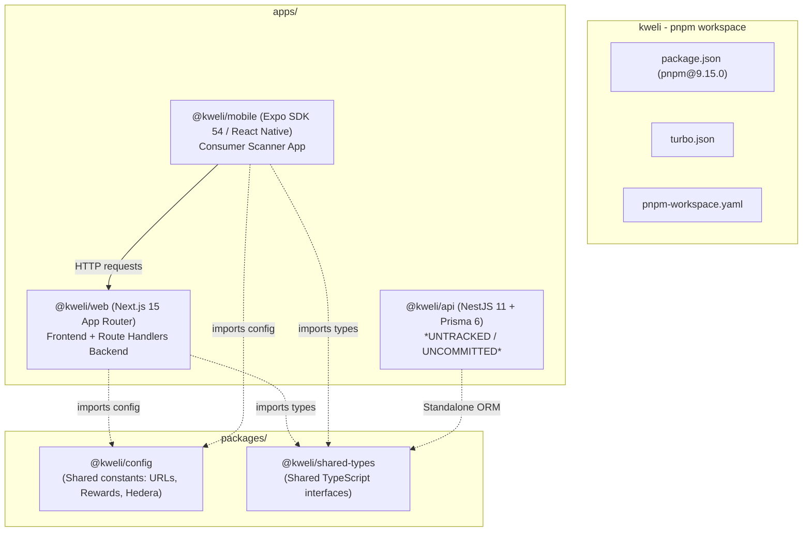

# KWELI — REPOSITORY AND ARCHITECTURE INVENTORY

**Document ID:** KW-AUDIT-02  
**Audit Date:** October 2026  
**Subject:** Codebase Structure, Workspaces, Dependency Health, and Component Lifecycle Assessment  

---

## 1. Repository & Version Control Context

| Property | Value / Evidence | Notes |
| :--- | :--- | :--- |
| **Git Remote Origin** | `https://github.com/Devnuelx/Kweli.git` | Primary remote repository |
| **Active Branch** | `main` | Local branch is ahead of `origin/main` by 2 commits |
| **Head Commit Hash** | `fb3b60dad4c7ff382096e19e9e7e5145347ac5f1` | Commit message: *"Saving the commit incase a rollback is needed"* |
| **Previous Key Commits** | `657cc74` (*before typescript migration*)<br/>`88be74f` (*Migrated to this repo after suspension*)<br/>`457695c` (*Updated project for Hedera Africa Hackathon*) | Evidence of account migrations, hasty pre-hackathon edits, and partially finished TypeScript rewrites. |
| **Working Tree State** | **Dirty (Untracked files & uncommitted diffs)** | Crucial changes untracked, including the entire `apps/api/` NestJS backend, new landing page components, and scan pages. |

---

## 2. Workspace & Monorepo Architecture

Kweli is structured as a `pnpm` monorepo orchestrated by Turborepo (`turbo.json`). However, workspace alignment is fractured.



### Monorepo Components & Package Inventory

| Package Directory | Package Name | Role | Technology Stack | Runtime & Tools | Status |
| :--- | :--- | :--- | :--- | :--- | :---: |
| `/` | `kweli` | Workspace Root | pnpm 9.15.0, Turbo 2.x | Node.js >= 18 | Fragile |
| `apps/web` | `@kweli/web` | Manufacturer Portal & V1/V2 Backend | Next.js 15.5.4, React 19.1.0, Tailwind CSS 3.4, Supabase JS 2.49, NextAuth 4.x, Hedera SDK 2.80 | Node.js 20.x, Vercel | Broken Builds |
| `apps/mobile` | `@kweli/mobile` | Consumer Verification Mobile App | Expo SDK 54, React Native 0.81.5, NativeWind 4.2, React Navigation 7, AsyncStorage | Expo Go, iOS, Android | Broken Runtime |
| `apps/api` | `@kweli/api` | V2 Dedicated REST API | NestJS 11.0, Prisma 6.0, Passport JWT, Swagger, Throttler, Hedera SDK 2.74 | Node.js 20.x, Express | Untracked / Incomplete |
| `packages/config` | `@kweli/config` | Shared Constants | TypeScript 5.9 | Node.js | Working |
| `packages/shared-types` | `@kweli/shared-types` | Shared TypeScript Definitions | TypeScript 5.9 | Node.js | Working |
| `docs` | N/A | Root Documentation | N/A | Markdown | **Empty Folder** |
| `submission-material` | N/A | Hackathon Artifacts | PDF, PNG | Pitch deck & certificate | Static |

---

## 3. Dependency, Build & Test Health Status

### Build Verification Findings

1. **Broken Workspace Junctions / Missing `node_modules` in Root:**
   - Command executed: `pnpm --filter @kweli/web build`
   - **Result:** FAILED (`Exit status 1`)
   - **Evidence:** `Error: Cannot find module 'C:\Users\user\Desktop\Kweli\apps\web\node_modules\next\dist\bin\next'`
   - **Root Cause:** In pnpm workspaces on Windows, project `node_modules` rely on junctions to `node_modules/.pnpm` in the workspace root. The root `node_modules` directory does not exist, breaking all package binaries across all workspaces.

2. **Linter Execution:**
   - Command executed: `pnpm --filter @kweli/web lint`
   - **Result:** FAILED (`Exit status 1`)
   - **Evidence:** `Error: Cannot find module '.../eslint/bin/eslint.js'`

3. **Conflicting Route Entries in Next.js App Router:**
   - Directory: `apps/web/app/(public)/scan/`
   - **Finding:** Both `page.js` (123 lines) and `page.tsx` (717 lines) exist simultaneously in the same route folder. In Next.js App Router, having multiple conflicting page extensions (`page.js` and `page.tsx`) in the same folder causes build ambiguity and compilation failures.

4. **Zero Automated Tests:**
   - Commands executed: Recursive searches for `*.test.*`, `*.spec.*`, and `__tests__` directories.
   - **Result:** Exactly **0 test files exist in the entire codebase**.
   - **Coverage:** **0.00% across unit, integration, and end-to-end tests.**

---

## 4. Entry Points, Routing & Architecture Decomposition

### A. Web Application (`apps/web`)

- **Root Layout & Entry:** `apps/web/app/layout.js`, `apps/web/app/providers.js`
- **Public Routes:**
  - `/` (`apps/web/app/(public)/page.js`): Consumer and enterprise landing page.
  - `/business` (`apps/web/app/(public)/business/page.js`): B2B marketing landing page.
  - `/login` (`apps/web/app/(public)/login/page.js`): Company login portal (NextAuth).
  - `/signup` (`apps/web/app/(public)/signup/page.js`): Company self-registration.
  - `/scan` (`apps/web/app/(public)/scan/page.tsx`): Camera-based in-browser QR scanner using `jsQR`.
  - `/report` (`apps/web/app/(public)/report/page.js`): Consumer counterfeit reporting form.
  - `/waitlist` (`apps/web/app/(public)/waitlist/page.js`): Pre-launch waitlist registration.
  - `/v/[serial]` (`apps/web/app/v/[serial]/page.jsx`): Direct QR landing page for serialized units.
- **Protected Dashboard Routes (`/dashboard/*`):**
  - Protected via `apps/web/middleware.ts` (NextAuth session check).
  - `/dashboard`: High-level metrics, scan trends, world map view.
  - `/dashboard/products`: Batch and serialized unit list, QR download modal.
  - `/dashboard/products/import`: CSV bulk batch registration.
  - `/dashboard/templates`: Banner design template upload & OCR placement detector.
  - `/dashboard/campaigns`: Instant-win campaign setup and prize configuration.
  - `/dashboard/settings`: Company profile, Flutterwave payment trigger, API key view.
  - `/dashboard/docs`: In-app API documentation for developers.
  - `/dashboard/onboarding`: Initial brand setup wizard.
- **Backend API Routes (`apps/web/app/api/*`):**
  - 32 separate Next.js route handlers serving as Kweli's primary backend.

### B. Mobile Application (`apps/mobile`)

- **Entry Point:** `apps/mobile/app/index.tsx` (redirects to `(tabs)` or `auth/login`).
- **Framework:** Expo Router v6 (`expo-router/entry`).
- **Navigation Tabs (`apps/mobile/app/(tabs)/*`):**
  - `index.tsx`: Scanner tab with camera view (`expo-camera`), flashlight toggle, and AI photo capture (`expo-image-picker`).
  - `wallet.tsx`: Points/rewards balance, rank tiers, transaction history, and redemption placeholders.
  - `history.tsx`: List of local and synced product verifications.
- **Other Screens:**
  - `auth/login.tsx`: Consumer email/password login and account creation.
  - `achievements.tsx`: Badge milestones (1, 10, 50, 100 scans).
  - `result/result.jsx`: Product verification result card.

### C. Dedicated REST API (`apps/api` - *Untracked*)

- **Entry Point:** `apps/api/src/main.ts` (NestJS bootstrap on port 4000 with Swagger at `/docs`).
- **Global Configuration:** Global `api/v1` prefix, validation pipes, global throttler (rate limiter), logging and transformation interceptors.
- **Modules:**
  - `AuthModule`: Company and Consumer JWT authentication.
  - `ProductsModule`: Product registration and batch generation.
  - `VerificationModule`: QR scan evaluation and Gemini AI verification.
  - `ReportsModule`: Counterfeit report submission and tracking.
  - `CampaignsModule`: Instant-win RNG logic and prize tracking.
  - Core Modules: `DatabaseModule` (Prisma), `HederaModule` (HCS/HTS), `AiModule`, `QrModule`, `CsvModule`, `NotificationsModule` (Resend/Termii), `StorageModule` (Supabase).

---

## 5. Environment Variables & Configuration Requirements

> [!IMPORTANT]
> The following is a catalog of environment variable names required across the Kweli components. No secret values are exposed.

| Scope | Environment Variable Name | Purpose | Criticality |
| :--- | :--- | :--- | :---: |
| **apps/web** | `NEXT_PUBLIC_SUPABASE_URL` | Supabase project endpoint | Mandatory |
| **apps/web** | `NEXT_PUBLIC_SUPABASE_ANON_KEY` | Public client API key | Mandatory |
| **apps/web** | `SUPABASE_SERVICE_ROLE_KEY` | Administrative database key (bypasses RLS) | Mandatory |
| **apps/web** | `HEDERA_ACCOUNT_ID` | Treasury operator account ID (`0.0.xxxxx`) | Mandatory |
| **apps/web** | `HEDERA_PRIVATE_KEY` | Treasury operator private signing key | Mandatory |
| **apps/web** | `HEDERA_TOPIC_ID` | Default fallback HCS topic ID | Mandatory |
| **apps/web** | `HEDERA_TOKEN_ID` | VFY/KWL Hedera Token Service ID | Mandatory |
| **apps/web** | `HEDERA_PAT` | Hedera Portal Access Token | Optional |
| **apps/web** | `NEXTAUTH_URL` | Canonical URL for authentication redirects | Mandatory |
| **apps/web** | `NEXTAUTH_SECRET` | Secret used to sign session cookies & consumer JWTs | Mandatory |
| **apps/web** | `NEXT_PUBLIC_APP_URL` | Public frontend URL for QR link generation | Mandatory |
| **apps/web** | `OPENAI_API_KEY` | API key for legacy OpenAI Vision calls | Optional |
| **apps/web** | `GEMINI_API_KEY` | API key for Gemini 2.5 Flash product verifier | Mandatory |
| **apps/web** | `FLUTTERWAVE_SECRET_KEY` | Secret key for Flutterwave payments | Optional (Fallbacks to dummy bypass) |
| **apps/web** | `RESEND_API_KEY` | Email notification delivery key | Optional |
| **apps/web** | `TERMII_API_KEY` | Nigerian SMS notification delivery key | Optional |
| **apps/api** | `DATABASE_URL` | PostgreSQL connection string for Prisma | Mandatory |
| **apps/api** | `HEDERA_NETWORK` | `testnet` or `mainnet` | Optional (default: `testnet`) |
| **apps/api** | `ADMIN_EMAILS` | Comma-separated admin whitelist | Optional |
| **apps/api** | `FRONTEND_URL` | Allowed CORS origins | Optional |
| **apps/api** | `PORT` | Listening port for NestJS (default: 4000) | Optional |

---

## 6. Dead Code, Incomplete Modules & Discarded Files

```
kweli/
├── backup.js                                     [DEAD CODE: 493 lines of unversioned landing page backup dumped in root]
├── apps/web/app/api/products/verify/route.js     [DEAD CODE: 253 lines of commented-out legacy verification route]
├── apps/web/app/(public)/scan/page.js            [DEAD CODE: 123 lines of commented-out legacy scanner UI]
├── apps/web/app/api/debug-auth.js                [SECURITY RISK: Exposed debug route displaying session state]
├── apps/mobile/app/result/result.jsx             [ABANDONED: Legacy JSX result screen superseded by tab results]
└── apps/mobile/app/**/*.web.tsx                  [DUPLICATE CODE: 6 redundant web-specific mobile screens diverging from native]
```

### Key Abandoned & Incomplete Modules

1. **`apps/web/lib/services/billing/FlutterwaveProvider.ts` (Lines 64-67):**
   - Implements a dummy fallback when `FLUTTERWAVE_SECRET_KEY` is missing that returns `{ status: 'successful' }`, allowing anyone to upgrade subscription tiers without paying.
2. **`apps/mobile/services/api.ts` (Lines 224-271):**
   - Calls `POST /api/user/sync` and `GET /api/user/wallet/:userId`. Neither route exists in `apps/web/app/api`.
3. **`apps/web/components/WorlMap.js`:**
   - Map points are hardcoded or misaligned with real geolocation coordinates from scans.
4. **`backup.js`:**
   - 493-line file left in repository root containing obsolete landing page code from an emergency commit.

---

## 7. Functional Inventory: Implemented, Partial & Missing

| Capability | Specified in Vision / Docs | Actual Code State | Verdict |
| :--- | :--- | :--- | :---: |
| **Company Sign-up** | Self-serve brand registration | Working (`/api/auth/signup`) | **Working** |
| **KYB Verification** | Vetted brand identity check | Completely missing; no approval gate | **Missing** |
| **Product Registration** | Single product & batch creation | Generates batch & serialized UUIDs | **Working** |
| **Bulk CSV Import** | Fast import of 1,000s of units | Synchronous Hedera loop; times out on Vercel | **Broken** |
| **QR Generation & Download** | Download PNG/ZIP/PDF of codes | Fails on Select All due to ID mismatch | **Partial** |
| **Packaging Banner Embedding**| Auto-embed QR into packaging | Canvas & Jimp placement exists | **Partial** |
| **Product Verification (QR)** | Instant authenticity proof | Simple DB check (`scan_count === 0`); no crypto | **Partial / Insecure** |
| **AI Photo Verification** | Computer vision counterfeit check | Gemini prompt + scraped Google search; unscientific | **Flawed** |
| **Token Rewards ($VFY)** | Hedera Token Service rewards | Unauthenticated transfer endpoint; open to theft | **Critical Risk** |
| **Airtime / Data Redemption**| Redeem tokens for telco credits | Hardcoded modal: *"This feature is coming soon!"* | **Missing** |
| **Instant-Win Campaigns** | Promotional rewards on verify | Code queries non-existent columns; race conditions | **Broken** |
| **Counterfeit Reporting** | User reports fake goods | Form works, but auto-rewards 5 VFY with no review | **Exploitable** |
| **Brand Analytics Dashboard** | Real-time scan & counterfeit stats | Query crashes on column name mismatch (`scanned_at`) | **Broken** |
| **Hedera Ledger Audit** | Immutable tamper-proof ledger | Write-only; messages are never read or verified | **Incomplete** |
| **Developer API & SDK** | Public API keys for ERPs | API key exists in DB but is never checked anywhere | **Missing** |

---

## 8. Component Disposition Table

| Major Component | Location | Recommendation | Rationale |
| :--- | :--- | :---: | :--- |
| **Monorepo Workspace** | Root (`package.json`, `pnpm-workspace.yaml`) | **Refactor** | Reorganize into a clean pnpm monorepo; delete abandoned files; repair workspace linking. |
| **Manufacturer Web Portal** | `apps/web` | **Refactor** | Retain Next.js frontend UI components; strip all API route handlers and point to dedicated backend. |
| **Backend REST API** | `apps/web/app/api/*` | **RETIRE / REPLACE** | Deprecate Next.js route handlers as backend; migrate to dedicated, audited NestJS or Fastify API. |
| **NestJS Backend Core** | `apps/api` | **REFACTOR & PROMOTE** | Commit to version control; resolve Prisma schema discrepancies; enforce strict auth guards; make primary API. |
| **Consumer Mobile App** | `apps/mobile` | **POSTPONE / REFACTOR** | Fix API path bugs; remove duplicate `.web.tsx` files; align with V2 API; defer until Pilot 2. |
| **In-Browser Scanner** | `apps/web/app/(public)/scan/page.tsx` | **KEEP & REFINE** | Excellent camera integration and mobile-friendly web experience. Ideal primary interface for Pilot 1. |
| **AI Image Verifier** | `ProductVerifier.ts` | **RETIRE FROM AUTH** | Scraping Google and aesthetic heuristic scoring cannot prove authenticity. Demote to cosmetic label inspection. |
| **Hedera HCS Integration** | `lib/hedera/hcs.ts` | **REVISE & DECOUPLE** | Make asynchronous queue-based; do not block user HTTP requests; implement mirror node verification reader. |
| **Hedera HTS Rewards** | `lib/hedera/transferToken.ts` | **REBUILD** | Remove client-triggered transfers; enforce strict server-side escrow, point ledgers, and rate limits. |
| **Shared Packages** | `packages/config`, `packages/shared-types` | **KEEP & EXPAND** | Clean, well-structured foundations for sharing schemas between web, mobile, and backend. |
