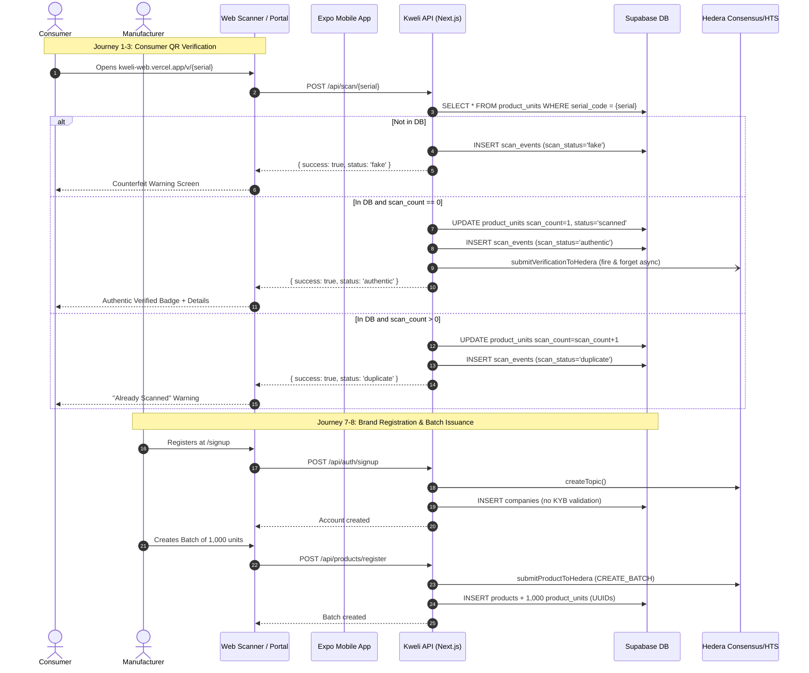

# KWELI — CURRENT PRODUCT AND USER JOURNEY AUDIT

**Document ID:** KW-AUDIT-03  
**Audit Date:** October 2026  
**Subject:** End-to-End Tracing, Usability, Accessibility, and Failure Modes Across Consumer, Manufacturer, and Developer Experiences  

---

## 1. Overview of Journeys Audited

This audit traces the actual execution paths of all documented user journeys across Kweli’s touchpoints:
1. **Web In-Browser Verification** (`apps/web`)
2. **Mobile Consumer Application** (`apps/mobile`)
3. **Manufacturer Business Portal** (`apps/web/app/(app)/dashboard`)
4. **Developer Integration & Documentation** (`apps/web/docs`, `apps/web/app/api`)



---

## 2. Journey-by-Journey Analysis

---

### Journey 1: Consumer Opens the Application

#### A. Mobile Native App (`apps/mobile`)
- **Entry Point:** App launch (`apps/mobile/app/index.tsx`).
- **Screens Involved:** Splash Screen -> Root Layout (`apps/mobile/app/_layout.tsx`) -> Redirect to `(tabs)/index.tsx`.
- **Data Retrieved:** Reads cached user record, tokens, scan streak, and achievements from local `AsyncStorage` (`services/storage.ts`).
- **Authentication:** None required to view scanner; guest profile initialized locally with zero points.
- **End-to-End Status:** **Partial / Fragile**.
  - Loads locally on device/Expo Go.
  - However, immediately attempts to sync with the server via `syncUserData()` calling `${API_BASE_URL}/api/user/sync` (`services/api.ts` line 231). This endpoint **does not exist** on the server, resulting in silent HTTP 404 network errors in the background console.
- **Usability & Accessibility:** Clean tab layout, but user sees cached/zero balance with no network connectivity indicator.

#### B. Web Browser Scanner (`apps/web`)
- **Entry Point:** `https://kweli-web.vercel.app/scan` (`apps/web/app/(public)/scan/page.tsx`).
- **Screens Involved:** `WebScanPage` landing prompt -> Camera stream overlay.
- **Data Retrieved:** Reads `dailyScans` from `localStorage`.
- **Authentication:** None (open public tool).
- **End-to-End Status:** **Working**.
  - Requests camera permissions via standard HTML5 `navigator.mediaDevices.getUserMedia`.
  - Prompts clearly with responsive modern UI, vibration feedback, and flash/stream switching.

---

### Journey 2: Consumer Scans a Product or Enters a Code

#### A. Mobile Native App (`apps/mobile`)
- **Entry Point:** Scanner tab (`apps/mobile/app/(tabs)/index.tsx`).
- **Screens Involved:** `CameraView` with scanning frame overlay.
- **Trigger:** Barcode detected event (`onBarcodeScanned`).
- **API Call Executed:** `verifyQRCode(hash)` in `apps/mobile/services/api.ts` (Line 36).
- **CRITICAL DEFECT IDENTIFIED (CONFIRMED):**
  - Line 36 executes: `fetch(`${API_BASE_URL}/products/scan/${encodeURIComponent(hash)}`)`.
  - **Notice the missing `/api` prefix!**
  - The actual backend endpoint is deployed at `/api/products/scan/[qr_hash]`.
  - Calling `/products/scan/...` against Vercel hits the Next.js frontend router instead of the API route handler, returning an HTML 404 page.
  - Parsing HTML as JSON (`await response.json()`) throws an unhandled SyntaxError, causing the app to display: *"Network error. Please check your connection and try again."*
- **End-to-End Status:** **BROKEN (Total Failure)**.
  - The mobile scanner **cannot verify any QR code** against the deployed production backend without manual code intervention.

#### B. Web In-Browser Scanner (`apps/web`)
- **Entry Point:** `/scan` (`apps/web/app/(public)/scan/page.tsx`).
- **Execution Path:**
  - `jsQR` scans video canvas frames at 60fps.
  - Extracts decoded string:
    - If string is a URL like `kweli-web.vercel.app/v/{serial}`, extracts `serial` and calls `POST /api/scan/{serial}`.
    - If string contains `?hash=...` or a 64-char hex string, calls `GET /api/products/scan/{hash}`.
  - Also supports manual code input modal.
- **End-to-End Status:** **Working**.
  - Camera acquisition, QR frame parsing, and code resolution function as expected on mobile browsers.

---

### Journey 3: Consumer Receives a Verification Result

#### A. Direct Serial URL (`/v/[serial]`)
- **Entry Point:** Consumer scans physical QR containing `https://kweli-web.vercel.app/v/3c2a8f90-1234-...` with any phone camera.
- **Screens Involved:** `apps/web/app/v/[serial]/page.jsx`.
- **API Endpoint:** `POST /api/scan/[serial]`.
- **Verification States Rendered:**
  1. **Loading State:** Spinner displays: *"Verifying Product... Checking cryptographic signatures via Hedera Hashgraph."* (Misleading claim: no signatures or Hedera checks occur).
  2. **Authentic State (scan_count == 0):**
     - Large green check badge: *"Product Verified as Authentic"*.
     - Shows product name, brand name, and total scan count (1).
     - Confetti animation.
  3. **Duplicate / Suspicious State (scan_count > 0):**
     - Yellow warning icon: *"Already Scanned"*.
     - Displays: *"This product was already verified previously... Note: If you just scanned this a moment ago, the product is authentic. If this is your first time scanning, it may be a duplicate or compromised code."*
     - Button: *"Report Suspicious Activity"* linking to `/report`.
  4. **Counterfeit Warning (Record not found in DB):**
     - Red warning icon: *"Counterfeit Warning — This QR code is not recognized in our database. Do not consume or use this product."*
     - Button: *"Report this Product"* linking to `/report`.
- **End-to-End Status:** **Working as implemented, but structurally insecure.**
  - Works functionally in browser.
  - Security flaw: A photocopied QR code scanned in a store before purchase is marked **"AUTHENTIC"** on the first scan. Subsequent scans excuse the duplicate as *"you just scanned this a moment ago."*

#### B. AI Photo Verification (`/api/verify-ai`)
- **Entry Point:** Mobile camera snap or web upload.
- **Execution:** Calls Gemini 2.5 Flash Vision, extracts visual text, runs a scraped Google search, and computes an aesthetic score (0-100).
- **Result:** If overall score >= 70, outputs *"Product verified successfully"* and awards 5 VFY tokens.
- **End-to-End Status:** **Flawed & Dangerous**.
  - A clean counterfeit package passes with high packagingQuality and is certified as genuine.
  - Scraped Google search (`axios.get('https://www.google.com/search?q=...')`) violates Google Terms of Service and is routinely blocked by Google CAPTCHAs in production.

---

### Journey 4: Consumer Views Product Details

- **Screens Involved:** Result modal/card in `/scan` and `/v/[serial]`.
- **Data Displayed:**
  - Product Name, Manufacturer / Brand Name.
  - Batch Number, Expiry Date, Manufacturing Date (if populated).
  - Outbound link: *"View on Hashscan"* linking to `https://hashscan.io/testnet/topic/{topic_id}` or `https://hashscan.io/testnet/transaction/{tx_id}`.
- **Missing Information:**
  - No batch recall status displayed.
  - No ingredient, composition, or dosage warnings.
  - No laboratory test certificates or NAFDAC / regulatory registration numbers shown.
  - Hashscan link opens testnet explorer with raw JSON bytecode that is unreadable to consumers.
- **End-to-End Status:** **Partial**.

---

### Journey 5: Consumer Reports a Suspicious Product

- **Entry Point:** `/report` (`apps/web/app/(public)/report/page.js`).
- **Screens Involved:** Report submission form -> Success / Confirmation view.
- **Fields:** Product Name, Brand Name, Location, Description, Image Upload (drag-and-drop or camera snap).
- **API Endpoint:** `POST /api/products/report-fake`.
- **Backend Behavior:**
  1. Uploads photo to Supabase storage bucket `reports`.
  2. Inserts record into `fake_reports` table (`status: 'pending'`).
  3. Asynchronously submits an HCS message (`action: 'REPORT_FAKE'`).
  4. **CRITICAL EXPLOIT:** If the user is logged in, immediately updates `users.total_rewards = total_rewards + 5` and executes an on-chain transfer of 5 VFY tokens from the treasury without any administrative validation!
- **End-to-End Status:** **Working but severely abusable**.
  - Works end-to-end for consumers.
  - Anyone can submit gibberish reports in an automated loop to steal treasury tokens.

---

### Journey 6: Consumer Creates an Account or Signs In

- **Mobile App:** `apps/mobile/app/auth/login.tsx` calling `POST /api/auth/consumer/signup` and `POST /api/auth/consumer/login`.
- **Web App:** Public users do not have a dedicated web login portal; `/login` is exclusively for manufacturer companies.
- **Backend Behavior:**
  - Password hashed with `bcrypt.hash(password, 10)`.
  - Generates JWT signed with `process.env.NEXTAUTH_SECRET` (valid for 7 days).
  - Token stored in phone's `AsyncStorage` (`auth_token`).
- **End-to-End Status:** **Working for mobile**.
  - Login/signup API works correctly.
  - Usability issue: There is no password reset, email verification, or "Forgot Password" capability.

---

### Journey 7: Manufacturer Registers & Manages an Account

- **Entry Point:** `https://kweli-web.vercel.app/signup` (`apps/web/app/(public)/signup/page.js`).
- **Screens Involved:** Registration form (Company Name, Email, Password, Phone, Address, City) -> Redirect to `/dashboard`.
- **API Endpoint:** `POST /api/auth/signup`.
- **Backend Execution:**
  1. Checks if email exists in `companies`.
  2. Hashes password (`bcrypt`).
  3. Generates 32-byte hex secret (`crypto.randomBytes(32).toString('hex')`).
  4. Calls Hedera `createTopic()` to provision a dedicated brand topic on testnet.
  5. Inserts a 14-day trial record into `subscriptions`.
  6. Inserts row into `companies` (`onboarding_complete: false`).
- **CRITICAL DEFECT IDENTIFIED (CONFIRMED):**
  - **Zero KYB (Know Your Business) verification.**
  - Anyone can register as *"Pfizer Pharmaceuticals"*, *"Guinness Nigeria"*, or *"Dangote Cement"*.
  - No proof of incorporation, business permit, or email domain ownership is required.
  - The fraudulent brand account immediately receives a valid Hedera topic and can start printing "authentic" Kweli QR codes.
- **End-to-End Status:** **Working functionally, but completely unvetted.**

---

### Journey 8: Manufacturer Creates a Product & Generates Identifiers

#### A. Single Batch Product Registration
- **Entry Point:** `/dashboard/products` -> Click *"Add Product"* button.
- **Screens Involved:** Product creation modal.
- **Fields:** Name, SKU, Category, Manufacturer, Batch Number, Batch Size (1 to 10,000), Manufacturing Date, Expiry Date.
- **API Endpoint:** `POST /api/products/register`.
- **Backend Execution:**
  - Creates row in `products`.
  - Generates `N` individual rows in `product_units` where `serial_code = crypto.randomUUID()` and `qr_url = https://kweli-web.vercel.app/v/${serial_code}`.
  - Submits batch creation record to Hedera HCS.
- **End-to-End Status:** **Working**.

#### B. Bulk CSV Import
- **Entry Point:** `/dashboard/products/import` (`apps/web/app/(app)/dashboard/products/import/page.js`).
- **Screens Involved:** Drag-and-drop CSV uploader (`components/CsvUploader.jsx`).
- **API Endpoint:** `POST /api/products/csv-import`.
- **CRITICAL DEFECT IDENTIFIED (CONFIRMED):**
  - Synchronous `for` loop over each row and quantity:
    ```javascript
    for (const row of csvRows) {
      for (let i = 0; i < quantity; i++) {
        // ...
        await submitProductToHedera(...); // Synchronous network call to Hedera!
      }
    }
    ```
  - For a batch of 100 units, executing 100 synchronous Hedera transactions takes 150-300 seconds.
  - Vercel serverless functions hard-timeout at 30 seconds (`vercel.json`).
  - **Result:** The import consistently crashes with HTTP 504 Gateway Timeout on any realistic production batch size.
- **End-to-End Status:** **BROKEN (Fails on batches > 10 units)**.

#### C. QR Code Export & Download
- **Entry Point:** `/dashboard/products` -> Click *"Download Selected"* or *"Download QR"*.
- **Screens Involved:** `DownloadModal.jsx`.
- **CRITICAL DEFECT IDENTIFIED (CONFIRMED):**
  - In `products/page.js` line 126: When user clicks "Select All", the UI populates `selectedProductIds` with `products.map(p => p.id)` (IDs from the `products` table).
  - In `ProductDownloader.ts` lines 74-75: The backend queries `product_units` using `.in('id', productIds)`.
  - Since product batch IDs do not match serialized unit IDs, the query returns 0 rows and crashes with: `Error: No products found`.
- **End-to-End Status:** **BROKEN on bulk selection**.

---

### Journey 9: Manufacturer Views Scans & Analytics

- **Entry Point:** `/dashboard` (`apps/web/app/(app)/dashboard/page.js`).
- **Screens Involved:** Metrics cards, recent activity table, world map view.
- **API Endpoint:** `GET /api/products/stats`.
- **CRITICAL DEFECT IDENTIFIED (CONFIRMED):**
  - `stats/route.js` lines 59 and 70 execute:
    ```javascript
    .select('..., scanned_at, ...')
    .order('scanned_at', { ascending: false })
    ```
  - In the database migration (`V2_schema.sql` line 99), the timestamp column in `scan_events` is named `created_at`, NOT `scanned_at`!
  - **Result:** PostgreSQL rejects the query with `column scan_events.scanned_at does not exist`.
  - The API returns HTTP 500, causing dashboard charts and scan history to display empty or failed states.
- **End-to-End Status:** **BROKEN (Database Column Name Mismatch)**.

---

### Journey 10: Developer Accesses API Documentation & Integration

- **Entry Point:** `/dashboard/docs` (`apps/web/app/(app)/dashboard/docs/page.js`) and `apps/web/docs/API_QUICK_REFERENCE.md`.
- **Screens Involved:** In-app API documentation viewer with code snippets for curl, Node.js, and Python.
- **API Key Management:** `/dashboard/settings` displays masked API key (`kw_****************************1234`) and button to regenerate key (`/api/settings/api-key/regenerate`).
- **CRITICAL DEFECT IDENTIFIED (CONFIRMED):**
  - The documentation instructs developers to pass `Authorization: Bearer <API_KEY>` or use their company secret.
  - However, **NOT A SINGLE API ENDPOINT in `apps/web/app/api` checks, accepts, or validates an API key**.
  - Protected endpoints strictly check NextAuth session cookies (browser only).
  - If a partner ERP or developer sends an HTTP request with the API key, the request is rejected with HTTP 401 Unauthorized.
- **End-to-End Status:** **NON-FUNCTIONAL / PLACEHOLDER**.

---

## 3. Journey Audit Summary Table

| Journey | Actor | Primary Interface | Backend Route | End-to-End Status | Root Cause / Primary Defect |
| :--- | :--- | :--- | :--- | :---: | :--- |
| **1. Open App** | Consumer | Expo Mobile App | N/A | **Partial** | Silently 404s on missing `/api/user/sync` endpoint. |
| **2. Scan QR** | Consumer | Expo Mobile App | `/products/scan/[hash]` | **BROKEN** | URL missing `/api` prefix; throws JSON syntax error on 404 HTML. |
| **3. Web Scan** | Consumer | Browser (`/scan`) | `/api/scan/[serial]` | **Working** | Functions correctly; camera and manual entry work. |
| **4. Direct Verify** | Consumer | Browser (`/v/[serial]`) | `/api/scan/[serial]` | **Working** | Works, but falsely claims Hedera signature check; clone-vulnerable. |
| **5. AI Photo Verify** | Consumer | Mobile / Web | `/api/verify-ai` | **Flawed** | Heuristic aesthetics + scraped Google search; certifies fakes. |
| **6. Report Counterfeit**| Consumer | Web (`/report`) | `/api/products/report-fake`| **Working / Abusable** | Submits report, but immediately drains 5 VFY tokens with no review. |
| **7. Brand Sign-up** | Manufacturer | Web (`/signup`) | `/api/auth/signup` | **Working / Unvetted** | No KYB check; allows instant brand impersonation. |
| **8. Single Product** | Manufacturer | Web (`/dashboard`) | `/api/products/register` | **Working** | Successfully creates batch and serialized UUID units. |
| **9. Bulk CSV Import**| Manufacturer | Web (`/dashboard`) | `/api/products/csv-import` | **BROKEN** | Synchronous Hedera transactions inside loop hit Vercel 30s timeout. |
| **10. QR Download** | Manufacturer | Web (`/dashboard`) | `/api/products/download` | **BROKEN** | UI sends product batch IDs; backend expects unit IDs -> 0 rows. |
| **11. Analytics** | Manufacturer | Web (`/dashboard`) | `/api/products/stats` | **BROKEN** | SQL error: queries non-existent column `scan_events.scanned_at`. |
| **12. Developer API** | Developer | Docs / Settings | `/api/settings/api-key` | **NON-FUNCTIONAL** | API keys displayed in settings are ignored by all API endpoints. |
| **13. Reward Redeem** | Consumer | Mobile (`/wallet`) | None | **MISSING** | Hardcoded popup: *"This feature is coming soon!"* |
