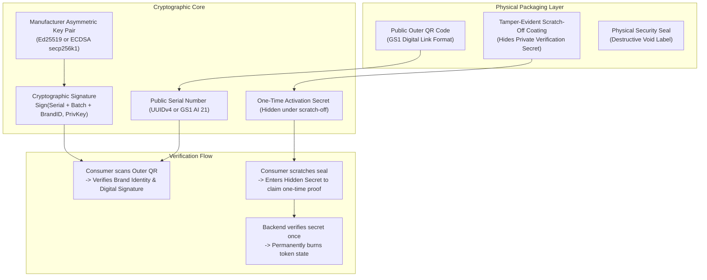

# KWELI — AUTHENTICATION AND COUNTERFEIT RESISTANCE THREAT MODEL

**Document ID:** KW-AUDIT-04  
**Audit Date:** October 2026  
**Subject:** Cryptographic Analysis, Threat Scenarios, Attack Matrix, and Anti-Counterfeiting Integrity Assessment  

---

## 1. Ground Truth: What Kweli Can and Cannot Currently Prove

Before evaluating complex attacks, the foundational question must be answered:  
**What does Kweli actually prove when it labels a product "AUTHENTIC" or "VERIFIED"?**

```
+--------------------------------------------------------------------------------------------------+
|                                     THE VERIFICATION TRUTH TABLE                                 |
+--------------------------------------------------------------------------------------------------+
| CLAIMED IN UI & MARKETING:                                                                       |
| "Checking cryptographic signatures via Hedera Hashgraph... Product verified as authentic!"       |
+--------------------------------------------------------------------------------------------------+
| MATHEMATICAL & SYSTEM REALITY:                                                                   |
| [X] Proves that an arbitrary string exists in PostgreSQL (table: products or product_units).    |
| [X] Proves that this string's scan_count integer column in PostgreSQL was equal to 0.           |
|                                                                                                  |
| [!] DOES NOT PROVE that the physical product in the box is authentic.                           |
| [!] DOES NOT PROVE that the packaging was manufactured by the authentic brand.                   |
| [!] DOES NOT PROVE that the label was not photocopied, cloned, or transferred to fake goods.     |
| [!] DOES NOT PROVE that the brand account that created the code is a legitimate legal entity.    |
| [!] DOES NOT CHECK any cryptographic signature on the client, server, or blockchain.             |
| [!] DOES NOT CHECK Hedera consensus state before rendering a verification badge.                 |
+--------------------------------------------------------------------------------------------------+
```

---

## 2. Current Authentication & QR Architecture

Kweli contains two competing identifier generation flows in the repository:

### Flow A: Hackathon V1 Static Hash Flow (`apps/web/lib/hedera/hash.ts`)
- **Code Generation:**
  ```typescript
  export function generateProductHash(productData: ProductHashData, companySecret: string): string {
    const dataString = JSON.stringify({
      productId: productData.productId,
      companyId: productData.companyId,
      batchNumber: productData.batchNumber,
      manufacturingDate: productData.manufacturingDate,
      salt: companySecret,
      timestamp: Date.now()
    });
    return crypto.createHash('sha256').update(dataString).digest('hex');
  }
  ```
- **Analysis:**
  1. **Documentation vs. Code Discrepancy:** The `README.md` claims: *"SHA-384 hashing for QR generation."* The code actually executes `sha256`.
  2. **Non-Deterministic One-Way Key:** Because `Date.now()` is embedded in the hash preimage, the hash is **irreproducible and unverifiable**. A verifier cannot recalculate the hash to verify authenticity—they can only query a centralized database to check if that 64-character hex string exists.
  3. **Batch Sharing:** In V1, all items in a batch or product line share the exact same `qr_hash`. Scanning item #1 or item #5,000 hits the same database row.

### Flow B: V2 Serialized Unit Flow (`apps/web/app/api/products/register/route.js`)
- **Code Generation:**
  ```javascript
  for (let i = 0; i < batchSize; i++) {
    const serial_code = crypto.randomUUID();
    units.push({
      product_id: product.id,
      serial_code,
      qr_url: `https://kweli-web.vercel.app/v/${serial_code}`,
      status: 'unscanned',
      scan_count: 0
    });
  }
  ```
- **Analysis:**
  1. **Standard UUIDv4:** `serial_code` is a standard pseudo-random UUID. It contains no digital signature, no brand public key identifier, no expiry timestamp, and no cryptographic message authentication code (HMAC).
  2. **Plain Web URL:** The QR code encodes a public URL (`kweli-web.vercel.app/v/{uuid}`). Anyone with a standard smartphone camera app who scans the code is directed to this web page.
  3. **Binary State Machine:**
     - `scan_count == 0` -> Marked `'authentic'`, `scan_count` incremented to 1.
     - `scan_count > 0` -> Marked `'duplicate'`.
     - Record missing -> Marked `'fake'`.

---

## 3. Threat Model & Attack-Scenario Matrix

The table below evaluates realistic commercial and adversarial attacks against Kweli's current implementation:

| Attack Scenario | Description | System Vulnerability / Defect | Attack Result | Severity | Confidence |
| :--- | :--- | :--- | :--- | :---: | :---: |
| **ATK-01: QR Clone / Photocopy Attack** | Counterfeiter buys 1 genuine pack of antibiotics, photocopies the QR label onto 1,000 counterfeit packs, and distributes them to pharmacies. | System cannot distinguish original physical label from photocopied label; first scanner gets "Authentic"; subsequent scans excused as *"already scanned"*. | **SUCCEEDS** (Catastrophic: Fake medicine certified authentic) | **CRITICAL** | Confirmed |
| **ATK-02: Retail Sniping / Pre-Sale Scan** | Bad actor walks through a pharmacy/market, scans 50 high-value products on the shelf with their phone without buying them. | Scanning an item immediately marks it as "scanned" (`scan_count=1`). When legitimate buyers purchase the item later, Kweli tells them: *"Already Scanned / Potential Duplicate"*. | **SUCCEEDS** (Destroys consumer confidence in genuine goods) | **HIGH** | Confirmed |
| **ATK-03: Brand Impersonation / Fake Issuer** | Counterfeit syndicate creates an account on Kweli using the name *"Pfizer Nigeria Ltd"* or *"GSK West Africa"*. | Zero KYB / identity verification on `/api/auth/signup`. No corporate registry or trademark check. | **SUCCEEDS** (Counterfeiters issue legitimately signed Kweli QRs under brand's name) | **CRITICAL** | Confirmed |
| **ATK-04: Treasury Drain Exploit** | Attacker calls `POST /api/transfer` with their own Hedera account ID and `amount: 100000`. | `/api/transfer` requires no authentication, no JWT, no API key, and no authorization checks. | **SUCCEEDS** (Treasury operator transfers real HTS tokens directly to attacker) | **CRITICAL** | Confirmed |
| **ATK-05: Fake Report Token Farming** | Attacker writes a 10-line Python script submitting 1,000 random counterfeit reports to `/api/products/report-fake`. | System awards 5 VFY tokens and immediately transfers them on-chain upon report submission with no human or algorithmic review. | **SUCCEEDS** (Attacker extracts 5,000 tokens in minutes) | **HIGH** | Confirmed |
| **ATK-06: Serial Number Enumeration** | Attacker attempts to guess valid serial numbers or QR hashes to print on counterfeit goods. | UUIDv4 has 122 bits of entropy; enumeration is computationally infeasible. | **FAILS** (UUIDv4 entropy protects against random guessing) | **LOW** | Confirmed |
| **ATK-07: IDOR Serial Extraction** | Attacker discovers company UUID and calls `GET /api/products/company/{company_id}`. | Endpoint is completely unauthenticated and leaks all products, batch numbers, and serial codes. | **SUCCEEDS** (Attacker gets all genuine serial numbers without guessing!) | **CRITICAL** | Confirmed |
| **ATK-08: AI Image Verification Bypass** | Counterfeiter prints a visually convincing box with sharp typography and uploads a photo to `/api/verify-ai`. | Gemini checks aesthetic packaging quality and Google search; high-quality packaging scores > 70. | **SUCCEEDS** (Deceptive counterfeit certified authentic by AI) | **HIGH** | Confirmed |
| **ATK-09: Replay Attack on Duplicate Scans** | Attacker repeats scans across different IP addresses or clears app data on phone. | In mobile app, duplicate checking is done in `AsyncStorage`. Clearing app data resets duplicate memory. | **SUCCEEDS** (Mobile app treats same code as brand new scan) | **HIGH** | Confirmed |
| **ATK-10: Denial of Service via CSV Import** | Attacker registers a trial company and uploads a CSV with 5,000 rows. | Backend runs synchronous Hedera transactions in a loop; exhausts execution time and memory. | **SUCCEEDS** (Vercel function crash / serverless DoS) | **MEDIUM** | Confirmed |

---

## 4. Detailed Breakdown of Critical Threat Scenarios

### Scenario 1: The "Photocopy & Excuses" Attack (ATK-01)

```mermaid
sequenceDiagram
    autonumber
    actor Counterfeiter
    actor Victim1 as Consumer A (Lagos)
    actor Victim2 as Consumer B (Kano)
    participant Kweli as Kweli Platform

    Counterfeiter->>Kweli: Buys 1 genuine medicine pack with Serial S-100
    Counterfeiter->>Counterfeiter: High-res photocopy of QR code on S-100 onto 500 fake packs
    Counterfeiter->>Victim1: Sells Fake Pack #1 to Pharmacy in Lagos
    Counterfeiter->>Victim2: Sells Fake Pack #2 to Chemist in Kano

    Victim1->>Kweli: Scans Fake Pack #1 (Serial S-100)
    Note over Kweli: DB check: S-100 exists, scan_count == 0
    Kweli-->>Victim1: 🟢 AUTHENTIC! (Scan Count = 1)
    Victim1->>Victim1: Consumes fake medication believing it is genuine!

    Victim2->>Kweli: Scans Fake Pack #2 (Serial S-100)
    Note over Kweli: DB check: S-100 exists, scan_count == 1
    Kweli-->>Victim2: 🟡 Already Scanned! Note: If you scanned this a moment ago, it is authentic.
    Victim2->>Victim2: Assumes previous scan was chemist or self; consumes fake medication!
```

**Why the current design fails:**  
The system relies on a purely digital, open 2D QR barcode. Any optical barcode can be copied for pennies. The backend’s only defense—a counter variable (`scan_count`)—is incapable of distinguishing between:
1. The genuine item being scanned by the real buyer.
2. A cloned fake item being scanned for the first time.
3. A store clerk checking the inventory before putting it on the shelf.

Furthermore, the UI copy on the "Already Scanned" warning actively undermines security by telling the user: *"If you just scanned this a moment ago, the product is authentic."*

---

### Scenario 2: The Direct BOLA/IDOR Serial Harvesting Attack (ATK-07)

1. An attacker registers a free account or observes network traffic in their browser.
2. The attacker identifies a manufacturer's `company_id` UUID from public product pages or API responses.
3. The attacker issues an unauthenticated HTTP request:
   ```bash
   curl -X GET "https://kweli-web.vercel.app/api/products/company/8f7b2c14-5d9e-4b8a-92a1-e4f617028b12"
   ```
4. **Vulnerability:** `apps/web/app/api/products/company/[company_id]/route.js` contains **zero authentication or authorization checks**.
5. **Payload Returned:** The API dumps the complete list of products, batch numbers, serial numbers, and QR hashes for that manufacturer.
6. **Exploitation:** The counterfeiter prints the real, unused serial codes onto counterfeit packaging *before* the manufacturer even distributes the genuine stock to retailers!

---

## 5. Security Assumptions vs. Physical Realities

| Stated / Implicit Assumption | Physical & Practical Reality |
| :--- | :--- |
| **"A valid QR code proves a genuine product."** | A QR code is an open, unencrypted 2D barcode. It proves only that the printer could reproduce black and white squares. It has zero intrinsic connection to the chemical contents of the container. |
| **"The first person to scan a code is the genuine consumer."** | In Nigerian and Sub-Saharan retail supply chains, products pass through open markets, wholesalers, distributors, logistics handlers, and retail clerks. Any of these intermediaries—or a browser in a shop—can scan the code first. |
| **"AI can verify product authenticity from a smartphone photo."** | Computer vision models evaluated on consumer phone photos cannot inspect micro-print resolutions, chemical compositions, blister-pack foil tensile strength, or forensic security inks. Counterfeiters routinely duplicate packaging aesthetics more cleanly than battered genuine boxes in transit. |
| **"Blockchain consensus prevents counterfeiting."** | Recording a transaction on Hedera proves that a server logged an entry at timestamp $T$. If the data entered was fraudulent, unvetted, or copied, the blockchain simply creates an immutable, permanent record of a fraud. |

---

## 6. Recommended Authentication Architecture for Pilot 1

To achieve genuine counterfeit resistance suitable for real commercial brands, Kweli must transition from **open static barcodes** to a **dual-layer physical-digital authentication model**:



### Core Requirements for Pilot 1:

1. **Two-Tier Identifier Scheme:**
   - **Layer 1 (Public Outer QR):** Encodes a GS1 Digital Link containing the public serial number and an ECDSA/Ed25519 digital signature generated by the brand's verified private key. Anyone can scan this to see genuine product details, batch expiry, and cryptographic proof of issuer identity.
   - **Layer 2 (Protected Activation Secret):** A single-use, 8-character high-entropy PIN concealed beneath a scratch-off latex coating or tamper-evident break seal. The product cannot be registered as "consumed" or claim rewards until this seal is physically scratched and entered.
2. **State Machine Transitions:**
   - `ISSUED` (Generated by verified brand)
   - `IN_TRANSIT` (Distributor scan)
   - `RETAIL_READY` (Pharmacist verification scan)
   - `CONSUMED / ACTIVATED` (First time scratch-off PIN entered by consumer; seal permanently burned)
   - `ALREADY CONSUMED` (Subsequent entries of scratch-off PIN; explicitly warns of packaging reuse!)
3. **Mandatory KYB Brand Validation:**
   - Brand accounts must pass automated corporate registry checks (e.g. CAC in Nigeria, SEC/Companies House globally) and domain ownership verification before being permitted to issue serial credentials.
