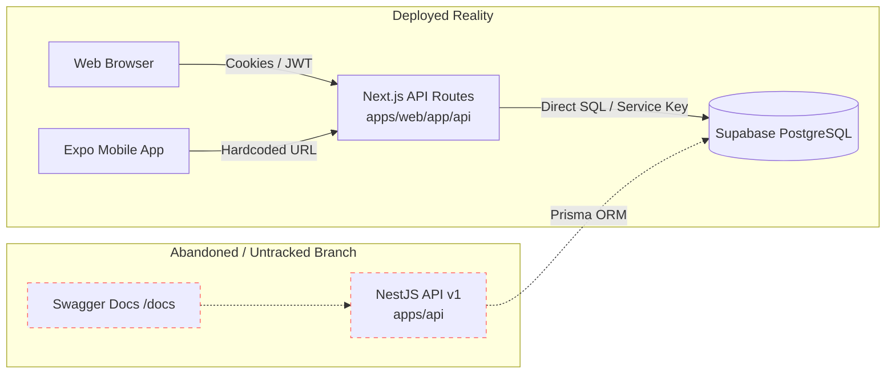
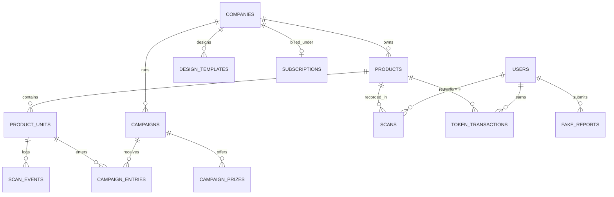

# KWELI — BACKEND, API, AND DATA ARCHITECTURE AUDIT

**Document ID:** KW-AUDIT-05  
**Audit Date:** October 2026  
**Subject:** Route Inventory, Schema Divergence, Multi-Tenant Boundaries, Access Control, and Database Integrity  

---

## 1. Architectural Overview & Dual-Backend Divergence

The Kweli monorepo suffers from an unresolved **split backend architecture**:

1. **Active Deployed Backend (`apps/web/app/api/*`):**
   - Implemented as 32 Next.js App Router route handlers.
   - Interacts directly with PostgreSQL via `@supabase/supabase-js`.
   - Mixes browser NextAuth session cookies with ad-hoc bearer JWTs.
   - Contains numerous unauthenticated endpoints, lacks schema validation pipes, and mixes business logic directly into route handlers.
2. **Untracked V2 Backend (`apps/api/*`):**
   - Implemented as a standalone NestJS 11 application with Prisma ORM 6.0.
   - Features modular architecture (`Auth`, `Products`, `Verification`, `Reports`, `Campaigns`), Swagger documentation, global rate-limiting (`ThrottlerModule`), and DTO validation.
   - **Critical Problem:** This codebase is **untracked in git**, omitted from root workspace build scripts, disconnected from mobile clients, and has never been deployed to staging or production.



---

## 2. API Route Inventory & Security Assessment

Below is the complete inventory of all 32 route handlers in `apps/web/app/api`, including authentication requirements, tenant checks, and verified vulnerabilities:

| Endpoint Route | HTTP Method | Auth Requirement | Tenant Check Enforced? | Observed Vulnerabilities & Flaws | Severity |
| :--- | :---: | :---: | :---: | :--- | :---: |
| `/api/auth/signup` | POST | None | N/A (Public) | Zero KYB; allows arbitrary brand impersonation. | **HIGH** |
| `/api/auth/[...nextauth]` | GET, POST | NextAuth | Self | Company login; relies on `companies` table. | Low |
| `/api/auth/consumer/signup` | POST | None | N/A (Public) | Consumer registration; bcrypt hash (10 rounds). | Low |
| `/api/auth/consumer/login` | POST | None | N/A (Public) | Issues 7-day JWT signed with `NEXTAUTH_SECRET`. | Low |
| `/api/associate` | POST | None | **NO** | Accepts raw `privateKey` in JSON; no auth! | **CRITICAL** |
| `/api/transfer` | POST | None | **NO** | **Direct treasury drain!** Transfers HTS tokens with no auth. | **CRITICAL** |
| `/api/mint` | POST | None | **NO** | Mints new Hedera tokens on demand with no auth. | **CRITICAL** |
| `/api/setup` | POST | None (DEV only) | **NO** | Provisions topics/tokens; blocked in prod. | Low |
| `/api/products/register` | POST | Session Cookie | Yes (`session.user.id`) | Batch size up to 10k; generates UUIDs. | Medium |
| `/api/products/csv-import` | POST | Session Cookie | Yes (`session.user.id`) | Synchronous Hedera loop causes 504 timeouts. | **HIGH** |
| `/api/products/list` | GET | Session Cookie | Yes (`session.user.id`) | Unbounded query: pulls all serialized units into memory. | **HIGH** |
| `/api/products/download` | POST | Session Cookie | Yes (`session.user.id`) | UI passes product IDs instead of unit IDs -> 0 rows. | **HIGH** |
| `/api/products/scan/[qr_hash]` | GET | None (Optional JWT) | **NO** | Replay vulnerability; awards 10 VFY on every scan. | **HIGH** |
| `/api/products/verify` | POST | **COMMENTED OUT** | N/A | **Dead code** (253 lines commented out). | Low |
| `/api/products/stats` | GET | Session Cookie | Yes (`session.user.id`) | SQL runtime error: queries non-existent column `scanned_at`. | **HIGH** |
| `/api/products/company/[id]` | GET | None | **NO** | **BOLA / IDOR:** Leaks all company products & serials. | **CRITICAL** |
| `/api/products/batch/[batch]` | GET | None | **NO** | **BOLA / IDOR:** Leaks all batch details without auth. | **HIGH** |
| `/api/products/report-fake` | POST | None (Optional JWT) | **NO** | Auto-rewards 5 VFY with no review (Token farming). | **HIGH** |
| `/api/scan/[serial]` | POST | None | N/A (Public verify) | Claims Hedera signature verification; none exists. | Medium |
| `/api/verify-ai` | POST | None (Optional JWT) | **NO** | Scraping Google search violates ToS; heuristic score. | **HIGH** |
| `/api/campaigns` | GET, POST | Session Cookie | Yes (`session.user.id`) | Schema column mismatch causes crash on insert. | **HIGH** |
| `/api/campaigns/enter` | POST | None | **NO** | RNG without DB locks; missing columns crash route. | **CRITICAL** |
| `/api/billing/setup` | POST | Session Cookie | Yes (`session.user.id`) | Initializes Flutterwave transaction. | Low |
| `/api/billing/verify` | GET | None | **NO** | **Free tier bypass:** Dummy verify upgrades to Enterprise. | **CRITICAL** |
| `/api/design-templates` | GET, POST | Session Cookie | Yes (`session.user.id`) | Uploads banner design templates to Supabase storage. | Low |
| `/api/design-templates/detect-placement` | POST | Session Cookie | Yes (`session.user.id`) | Heavy Tesseract.js OCR in serverless memory. | Medium |
| `/api/design-templates/upload` | POST | Session Cookie | Yes (`session.user.id`) | Template image uploader. | Low |
| `/api/settings/api-key` | GET | Session Cookie | Yes (`session.user.id`) | Masks company secret; key is never checked by APIs! | Medium |
| `/api/settings/api-key/regenerate` | POST | Session Cookie | Yes (`session.user.id`) | Changes secret, breaking legacy hash generation. | **HIGH** |
| `/api/user/history` | GET | Bearer JWT | Yes (`decoded.userId`) | Running balance math broken on pagination (page > 1). | Medium |
| `/api/onboarding/complete`| POST | Session Cookie | Yes (`session.user.id`) | Updates onboarding boolean in DB. | Low |
| `/api/waitlist` | POST | None | N/A (Public) | Waitlist submission. | Low |

---

## 3. Database Schema Divergence & Data Model Audit

### Schema Fragmentation

The project contains three conflicting representations of database schemas:
1. **Migration Files (`apps/web/database/migrations/*`):** Incremental SQL scripts (`003` to `007` and `V2_schema.sql`).
2. **Next.js Supabase Queries (`apps/web/app/api/*`):** Direct JavaScript queries against Supabase tables.
3. **Prisma Schema (`apps/api/prisma/schema.prisma`):** Introspected model used by the untracked NestJS backend.

### Critical Schema Contradictions

```
+---------------------------+-----------------------------------+-----------------------------------+
| ENTITY & FIELD            | V2_SCHEMA.SQL (DATABASE)          | CODE EXPECTATION (ROUTE HANDLERS) |
+---------------------------+-----------------------------------+-----------------------------------+
| scan_events (timestamp)   | created_at TIMESTAMPTZ            | scanned_at (in stats/route.js)    |
| campaign_prizes (name)    | tier_name TEXT                    | name (in campaigns/route.js)      |
| campaign_prizes (quota)   | max_winners INT                   | quantity (in campaigns/route.js)  |
| campaign_entries (win)    | won BOOLEAN                       | is_winner (in enter/route.js)     |
| products (identifier)     | qr_hash TEXT (V1)                 | serial_code UUID (V2 units)       |
| counterfeit reports       | counterfeit_reports table         | fake_reports table                |
+---------------------------+-----------------------------------+-----------------------------------+
```

### Table Inventory & Structural Deficiencies



#### 1. `companies` Table
- **Fields:** `id` (UUID PK), `name`, `email`, `password_hash`, `secret`, `hedera_topic_id`, `subscription_id`, `onboarding_complete`, `logo_url`, `industry`, `phone`, `address`, `city`, `country`, `subscription_tier`.
- **Defects:**
  - `secret` is stored in plaintext.
  - No status field (`active`, `suspended`, `pending_verification`, `revoked`). Once created, a company cannot be suspended by an administrator.

#### 2. `products` & `product_units` Tables
- **Dual Architecture Confusion:** `products` contains legacy V1 fields (`qr_hash`, `serial_number`, `units_generated`), while `product_units` contains serialized V2 items (`serial_code`, `qr_url`, `status`, `scan_count`).
- **Defects:**
  - Foreign key cascading: Deleting a batch in `products` does not have `ON DELETE CASCADE` defined in `V2_schema.sql` line 4, leading to foreign key violation errors on deletion.
  - Missing composite unique index on `(company_id, sku)`. A brand can register identical SKUs repeatedly.

#### 3. `users` Table
- **CRITICAL SECURITY RISK:** Stores unencrypted text fields `hedera_account_id` and `hedera_private_key` (`005_token_transactions.sql` lines 20-21). Storing custodial private keys in plaintext in PostgreSQL violates basic security standards.

#### 4. `scan_events` vs. `scans`
- Two separate tables track scan activity:
  - `scans`: Legacy V1 table tracking product ID, user ID, and boolean `is_authentic`.
  - `scan_events`: V2 table tracking `unit_id`, `scan_status`, IP, User-Agent, latitude, longitude, and Hedera TX ID.
- Analytics queries and reporting are split between both tables, producing contradictory scan counts.

---

## 4. Multi-Tenant Isolation Assessment

> [!CAUTION]
> **Tenant isolation in Kweli is severely broken.**

### 1. Disabled Row Level Security (RLS)
In file `apps/web/database/migrations/004_fix_rls_policies.sql`, RLS was explicitly disabled:
```sql
ALTER TABLE design_templates DISABLE ROW LEVEL SECURITY;
ALTER TABLE products DISABLE ROW LEVEL SECURITY;
ALTER TABLE companies DISABLE ROW LEVEL SECURITY;
```
Because RLS is disabled, data isolation is entirely dependent on application-level filtering in Next.js route handlers.

### 2. Application-Level BOLA / IDOR Leaks
Where application filtering exists, several routes completely omit tenant ownership checks:
- **`GET /api/products/company/[company_id]`:** Accepts any `company_id` parameter without verifying that the caller belongs to that company. An authenticated or unauthenticated attacker can view all competitors' products, serial numbers, and scan metrics.
- **`GET /api/products/batch/[batch_number]`:** Returns batch records across all companies matching a batch number.

---

## 5. Performance, Concurrency & Operational Risks

### 1. Unbounded Memory Allocation in `api/products/list`
In `apps/web/app/api/products/list/route.js` line 24:
```javascript
const { data: products, error } = await supabase
  .from('products')
  .select('*, product_units(*)')
  .eq('company_id', company.id);
```
- A manufacturer registering 10 batches of 5,000 units has 50,000 rows in `product_units`.
- Calling `/api/products/list` loads all 50,000 rows into serverless Node.js memory simultaneously without pagination, cursors, or limits.
- **Result:** Severe Node.js heap memory exhaustion and out-of-memory crashes on Vercel.

### 2. Concurrency Race Conditions on Campaign Prizes
In `apps/web/app/api/campaigns/enter/route.js` lines 94-97:
```javascript
await supabase
  .from('campaign_prizes')
  .update({ current_winners: wonPrize.current_winners + 1 })
  .eq('id', wonPrize.id);
```
- The application reads `current_winners`, adds 1 in JavaScript memory, and writes it back without a database transaction or atomic `UPDATE campaign_prizes SET current_winners = current_winners + 1 WHERE current_winners < max_winners`.
- If 50 users scan items simultaneously during a promotion, race conditions will award prizes far exceeding the maximum prize budget (`max_winners`).

---

## 6. Critical Missing Indexes & Constraints

| Table | Missing Constraint / Index | Consequence | Severity |
| :--- | :--- | :--- | :---: |
| `products` | UNIQUE(`company_id`, `sku`) | Duplicate product SKUs within the same company. | Medium |
| `product_units` | `status` IN ('unscanned', 'scanned', 'flagged') | Arbitrary invalid text statuses written to database. | Low |
| `campaign_prizes` | CHECK (`current_winners <= max_winners`) | Race condition allows unlimited over-allocation of prizes. | **CRITICAL** |
| `transactions` | UNIQUE (`reference_id`) | Duplicate payment verification processing. | **HIGH** |
| `scan_events` | INDEX (`created_at DESC`) | Dashboard analytics scan lookups slow to crawl at scale. | **HIGH** |
| `product_units` | FOREIGN KEY `ON DELETE CASCADE` | Orphaned unit records preventing batch deletions. | Medium |

---

## 7. Migration & Technical Debt Remediation Plan

```
Step 1: Unify on NestJS API (apps/api)
        ├── Discard Next.js API routes (apps/web/app/api)
        ├── Promote NestJS API as single source of truth
        └── Reconcile Prisma schema with actual PostgreSQL constraints

Step 2: Database Schema Hardening
        ├── Re-enable and enforce Supabase RLS on all tables
        ├── Standardize timestamp columns to created_at / updated_at
        ├── Add atomic check constraints (current_winners <= max_winners)
        └── Create missing composite indexes for multi-tenant isolation

Step 3: Security & Access Control Enforcement
        ├── Implement strict NestJS JWT Guards + Role Guards (Admin / Company / Consumer)
        ├── Require API Keys (Bearer kw_live_...) for B2B endpoints
        └── Delete unauthenticated /api/transfer, /api/mint, and /api/associate routes
```

- **Estimated Effort:** 3–4 engineer-weeks.
- **Risk Level:** Moderate (requires clean migration script without breaking existing hackathon test accounts).
