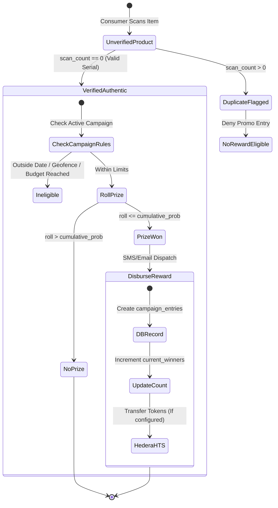
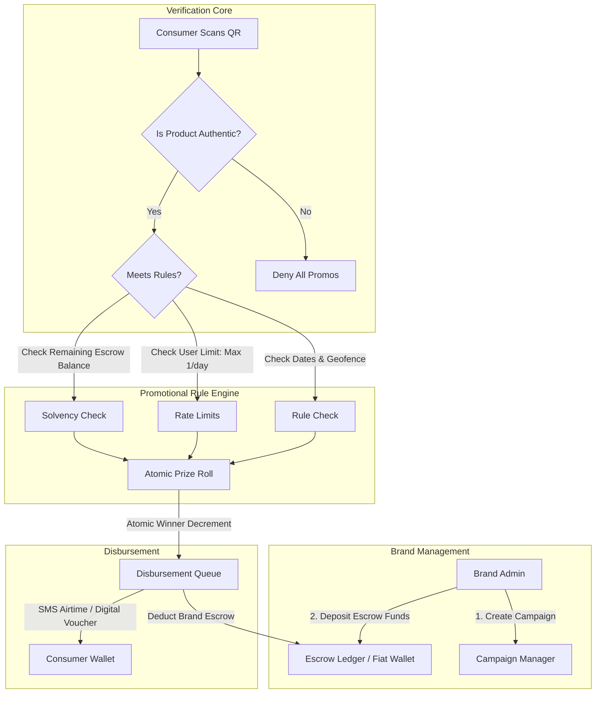
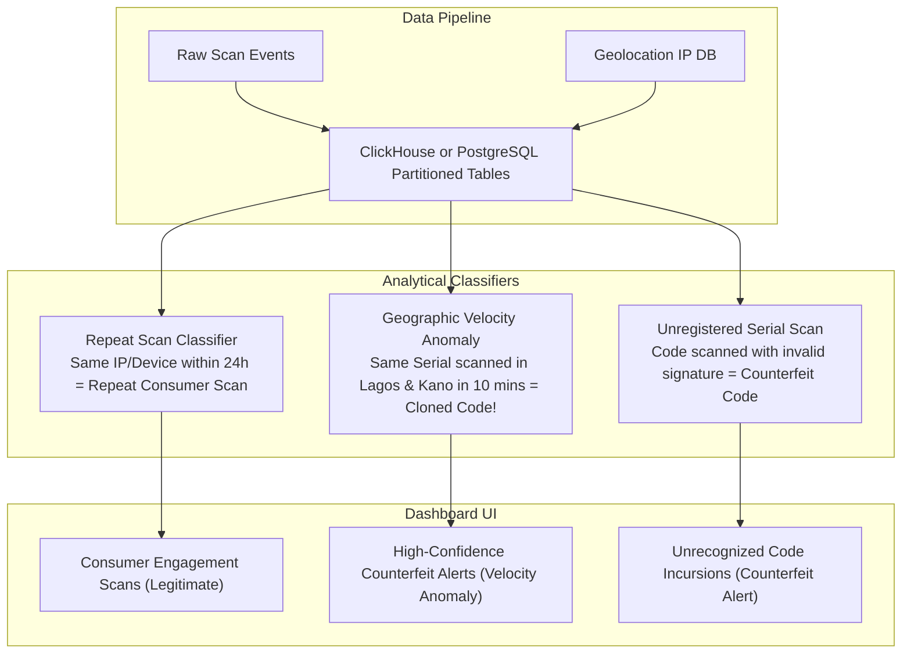

# KWELI — CAMPAIGNS, REWARDS, AND ANALYTICS AUDIT

**Document ID:** KW-AUDIT-06  
**Audit Date:** October 2026  
**Subject:** Promotional Systems, Reward Lifecycle, Anti-Fraud Financial Controls, Event Taxonomies, and Analytics Data Quality  

---

## 1. Existing Campaign & Reward Feature Inventory

Kweli’s vision combines anti-counterfeit verification with consumer engagement rewards (VFY tokens and brand-sponsored instant-win prizes). However, our audit reveals that **promotional eligibility is entangled with authentication**, financial escrow is non-existent, and reward distribution is open to severe automated abuse.



### Functional Inventory & Readiness

| Subsystem / Feature | Location in Code | Claimed Functionality | Actual Implementation | Commercial Status |
| :--- | :--- | :--- | :--- | :---: |
| **Campaign Creation** | `api/campaigns/route.js`, `dashboard/campaigns/page.jsx` | Schedule, budget, and prize tier configuration. | Inserts into `campaigns` and `campaign_prizes`. | **Partially Working** |
| **Instant-Win RNG** | `api/campaigns/enter/route.js` | Fair, probability-weighted prize distribution. | `Math.random()` loop; crashes on column name mismatches (`quantity` vs `max_winners`). | **BROKEN** |
| **Campaign Escrow** | Missing | Brand pre-funds rewards before launch. | **Completely absent.** Brands can configure \$50,000 in prizes with \$0 deposit. | **MISSING** |
| **Duplicate Claim Prevention** | `api/campaigns/enter/route.js` | One prize per unit serial. | Unique constraint on `(campaign_id, unit_id)`. | **Working** |
| **Per-User Claim Throttle**| Missing | Maximum 1 win per phone number per day. | **Completely absent.** A single phone number can win unlimited prizes. | **MISSING** |
| **QR Scan Reward** | `api/products/scan/[qr_hash]/route.js` | Earn 10 VFY on authentic scan. | Triggers unthrottled treasury transfer on every scan; abusable. | **Critical Risk** |
| **AI Verification Reward**| `api/verify-ai/route.js` | Earn 5 VFY on high-confidence scan. | Awards 5 VFY if Gemini score >= 70; abusable. | **High Risk** |
| **Telco Airtime / Data** | `apps/mobile/app/(tabs)/wallet.tsx` | Redeem VFY tokens for mobile airtime. | Hardcoded modal: *"This feature is coming soon!"* | **MISSING** |
| **Brand Reward Analytics**| `api/products/stats/route.js` | Real-time scan & reward expenditure. | SQL crashes on `scanned_at` column mismatch. | **BROKEN** |

---

## 2. Financial Abuse & Fraud Threat Model

```
+----------------------------------------------------------------------------------------------------+
|                                    CAMPAIGN & REWARD THREAT MATRIX                                 |
+----------------------------------------------------------------------------------------------------+
| THREAT 1: THE UNRESTRICTED TREASURY DRAIN (CRITICAL)                                               |
| - Route: POST /api/transfer                                                                        |
| - Mechanism: Unauthenticated endpoint allows direct requests: {"receiverId":"0.0.123", "amount":50000}|
| - Outcome: Direct, irreversible theft of all brand or platform tokens from treasury operator.    |
+----------------------------------------------------------------------------------------------------+
| THREAT 2: THE "PHANTOM SPONSOR" LIABILITY ATTACK (HIGH)                                            |
| - Route: POST /api/campaigns                                                                       |
| - Mechanism: Any company can create a campaign offering 1,000 PlayStation 5s or 100,000 NGN cash.  |
| - Defect: No escrow, bank account verification, or collateral deposit required.                     |
| - Outcome: Consumers win real promised prizes; brand defaults; Kweli faces severe legal liability. |
+----------------------------------------------------------------------------------------------------+
| THREAT 3: CONCURRENCY RACE CONDITIONS (OVER-DISBURSEMENT) (HIGH)                                  |
| - Route: POST /api/campaigns/enter                                                                 |
| - Mechanism: Current winners incremented via non-atomic update (read -> add 1 -> write).           |
| - Outcome: Under high traffic, 20 winners claim a prize tier capped at 5 winners.                  |
+----------------------------------------------------------------------------------------------------+
| THREAT 4: CAMPAIGN ENTRY WITHOUT VERIFICATION (MEDIUM)                                             |
| - Route: POST /api/campaigns/enter                                                                 |
| - Mechanism: Requires only valid serial_code; does not check if scan_count == 0 or status == 'verified'|
| - Outcome: Insiders or warehouse workers enter unverified inventory into campaigns.               |
+----------------------------------------------------------------------------------------------------+
```

---

## 3. Required Financial Controls & Architecture for Pilot 1

Promotions and rewards must be decoupled from the core cryptographic verification layer. **A successful product authentication is a prerequisite for promotional consideration, but never a guarantee of a financial payout.**



### Mandatory Rules for Pilot 1:

1. **Pre-Funded Escrow Lock:** No campaign may transition to `active` status unless the company has deposited sufficient escrow funds (e.g. Flutterwave/Paystack fiat deposit or funded token pool) to cover 100% of the maximum prize liability.
2. **Atomic Winner Allocation:**
   ```sql
   UPDATE campaign_prizes 
   SET current_winners = current_winners + 1 
   WHERE id = $1 AND current_winners < max_winners 
   RETURNING id, current_winners;
   ```
   If zero rows are updated, the prize tier is exhausted and the user receives a graceful "Better luck next time" outcome.
3. **Sybil & Claim Limits:**
   - Maximum 1 promotional entry per phone number / device fingerprint per 24 hours.
   - Phone numbers must be verified via OTP (One-Time Password) before claiming prizes exceeding 500 NGN (\$0.35).
4. **Separation of Concerns:** Verification logs (`scan_events`) must remain completely isolated from promotional entries (`campaign_entries`). An error in the campaign system must never invalidate an authentic product.

---

## 4. Analytics & Reporting Audit

Kweli aims to provide five distinct analytics capabilities:
- **Category A:** Authentication and counterfeit-risk analytics.
- **Category B:** Consumer engagement and product analytics.
- **Category C:** Campaign performance and reward expenditure.
- **Category D:** Operational and API reliability analytics.
- **Category E:** Business-level usage and billing analytics.

### Current Event Collection & Storage Reality

```
+-------------------+---------------------------------------+---------------------------------------+
| ANALYTICS DOMAIN  | DATA MODEL / COLLECTION POINT         | QUALITY & TRUST LEVEL                 |
+-------------------+---------------------------------------+---------------------------------------+
| Category A: Auth  | Table: scan_events                    | UNTRUSTWORTHY                         |
| & Counterfeits    | Captures: ip, user_agent, lat, lng    | Duplicates counted as "fraud attempts"|
|                   | Route: /api/scan/[serial]             | without checking if same user scanned.|
+-------------------+---------------------------------------+---------------------------------------+
| Category B:       | Table: product_units, scans           | PARTIAL / INACCURATE                  |
| Engagement        | Captures: scan_count, first_scanned_at| Local phone scans do not sync; total  |
|                   | Route: /api/products/stats            | scans corrupted by unthrottled replays|
+-------------------+---------------------------------------+---------------------------------------+
| Category C:       | Table: campaign_entries, prizes       | BROKEN                                |
| Campaigns         | Captures: consumer_phone, won, prize  | Column mismatches crash reporting;    |
|                   | Route: /api/campaigns                 | race conditions corrupt counts.       |
+-------------------+---------------------------------------+---------------------------------------+
| Category D:       | Vercel runtime logs only              | MISSING                               |
| Reliability       | No APM (Datadog, Sentry, OpenTelemetry)| No latency tracking, 504 tracking,    |
|                   | No structured API metric collection   | or error alerting configured.         |
+-------------------+---------------------------------------+---------------------------------------+
| Category E:       | Table: transactions, subscriptions    | UNRELIABLE                            |
| Billing           | Captures: status, tier, amount        | Dummy Flutterwave verify allows       |
|                   | Route: /api/billing/verify            | illegitimate free tier upgrades.      |
+-------------------+---------------------------------------+---------------------------------------+
```

---

## 5. Metric Calculation Logic & Mathematical Flaws

### 1. The "Fraud Attempts" Metric Fallacy
In `apps/web/app/api/products/stats/route.js` lines 46-50:
```javascript
const { count: duplicatesDetected } = await supabase
  .from('scan_events')
  .select('id, product_units!inner(products!inner(company_id))', { count: 'exact', head: true })
  .eq('product_units.products.company_id', company.id)
  .eq('scan_status', 'duplicate');
```
- **How it is presented in the Dashboard:** Displayed prominently as **"Fraud Attempts"**.
- **What it actually measures:** Every scan where `scan_count > 0`.
- **False Positive Reality:** If a consumer buys a genuine cough syrup bottle, scans it in the pharmacy, scans it again at home, and scans it a third time before taking a dose, Kweli records **2 "Fraud Attempts"** on the brand's dashboard!
- **Business Risk:** Brand executives looking at this dashboard see panic-inducing fake metrics claiming widespread counterfeiting of their products when it is simply normal consumer repeat engagement.

### 2. Runtime SQL Crash on Dashboard Statistics
In `apps/web/app/api/products/stats/route.js` lines 59 & 70:
```javascript
.select('id, serial_code, scan_status, scanned_at, latitude, longitude, ...')
.order('scanned_at', { ascending: false })
```
- Because column `scanned_at` does not exist in `scan_events` (migration defined `created_at`), the route handler crashes with HTTP 500.
- **The manufacturer analytics dashboard is currently completely non-functional.**

---

## 6. Recommended First Analytics Dashboard for Pilot 1

For the first commercial pilot, Kweli must deploy an honest, technically substantiated analytics dashboard that distinguishes **observed facts** from **inferred risks**.



### Essential Pilot Metrics:

1. **Total Units Issued vs. Activated:** Number of QR codes printed vs. first-time legitimate scans.
2. **Genuine Consumption Volume:** Count of unique physical units activated by consumers.
3. **Geographic Distribution:** Authentic scans mapped by state/city (using IP geolocation or optional GPS consent).
4. **Velocity Anomaly Detection (True Counterfeit Signal):**
   - Flag serial codes scanned across two distant locations (e.g. Lagos and Abuja) within a time window physically impossible for road or air travel.
   - This provides **actual mathematical proof of cloning**.
5. **Campaign Solvency & Claim Rate:** Total escrow allocated, claimed prizes, remaining balance, and active participant counts.

---

## 7. Data Privacy, Retention & Regulatory Risks

1. **IP & User-Agent Storage Without Explicit Consent:**
   - `scan_events` stores raw IP addresses (`ip_address TEXT`) and full user agent strings (`user_agent TEXT`) without anonymization or consumer privacy disclaimers.
   - **Compliance Breach:** In Nigeria (NDPR - Nigeria Data Protection Regulation) and globally (GDPR), IP addresses are considered Personal Data. Capturing and storing raw IPs during product scans without a published Privacy Notice violates statutory data protection guidelines.
2. **Recommendation:**
   - Hash or truncate IP addresses (e.g. `102.89.xxx.xxx`) upon ingestion.
   - Store approximate geographic coordinates (city/state level) rather than raw high-precision GPS coordinates unless explicit location permissions are granted by the consumer.
