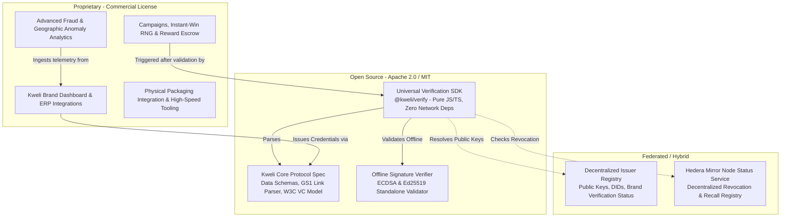

# KWELI — OPEN-SOURCE AND INTEROPERABILITY AUDIT

**Document ID:** KW-AUDIT-07  
**Audit Date:** October 2026  
**Subject:** Open-Source Readiness, Standards Compliance (GS1, W3C), Boundary Separation, Licensing, and Public SDK Specifications  

---

## 1. Executive Summary & Readiness Verdict

Kweli’s vision includes releasing open-source verification libraries and establishing an interoperable product-authentication protocol.

> [!WARNING]
> **The current codebase is NOT ready for public open-source publication.**  
> 1. Verification logic is tightly coupled to proprietary Supabase tables, Next.js server actions, and Vercel hosting.  
> 2. No standalone verification function exists. Checking a product requires direct access to Kweli’s internal PostgreSQL database.  
> 3. Identifiers do not conform to international supply chain standards (GS1 Digital Link) or verifiable credential standards (W3C VC/DID).  
> 4. Publication without repository history sanitization risks exposing development secrets, Supabase endpoints, and operational keys.

---

## 2. Standards Compliance & Interoperability Assessment

```
+-----------------------------------+-----------------------------------+-----------------------------------+
| STANDARD / SPECIFICATION          | CURRENT KWELI IMPLEMENTATION      | COMPLIANCE STATUS & DEFECT        |
+-----------------------------------+-----------------------------------+-----------------------------------+
| GS1 Digital Link (ISO/IEC 18974)  | Custom URL:                       | NON-COMPLIANT                     |
| Standard for web-URI identifiers  | https://kweli-web.vercel.app/v/   | Does not use standard GTIN (01)   |
| on consumer goods                 | {uuid}                            | or Serial Number (21) AI keys.    |
+-----------------------------------+-----------------------------------+-----------------------------------+
| W3C Verifiable Credentials (VC)   | Unsigned JSON stored in           | NON-COMPLIANT                     |
| Standard for tamper-evident       | PostgreSQL & written as raw JSON  | Lacks cryptographic proof object, |
| digital claims                    | to Hedera HCS.                    | credentialSubject, and context.   |
+-----------------------------------+-----------------------------------+-----------------------------------+
| Decentralized Identifiers (DID)   | Custom UUID string assigned to    | NON-COMPLIANT                     |
| W3C DID Core 1.0                  | brand companies.                  | Brands do not possess DIDs (e.g.  |
|                                   |                                   | did:hedera:..., did:web:...).     |
+-----------------------------------+-----------------------------------+-----------------------------------+
| ISO/IEC 15459                     | Random UUIDv4                     | NON-COMPLIANT                     |
| Unique identification of products |                                   | Lacks Issuing Agency Code (IAC).  |
+-----------------------------------+-----------------------------------+-----------------------------------+
```

### Detailed Standards Gaps

#### 1. GS1 Digital Link Non-Compliance
- Real-world pharmaceutical packaging, food items, and consumer electronics already incorporate GS1 barcodes (EAN-13, DataMatrix, or QR).
- A compliant GS1 Digital Link follows the structure:
  `https://brand.domain.com/01/{GTIN}/21/{SERIAL}?10={BATCH}&17={EXPIRY}`
- Kweli currently generates:
  `https://kweli-web.vercel.app/v/{random_uuid}`
- **Impact:** Retailers, point-of-sale barcode scanners, hospital inventory systems, and standard logistics ERPs cannot parse Kweli QR codes. A brand adopting Kweli would have to print **two separate QR codes**—one for international retail compliance and one for Kweli.

#### 2. W3C Verifiable Credentials Non-Compliance
- Kweli logs batch registrations as plain JSON strings to Hedera HCS:
  ```json
  {
    "action": "REGISTER_PRODUCT",
    "timestamp": "2026-...",
    "data": { "name": "Aspirin", "batchSize": 100 }
  }
  ```
- This record lacks:
  - An issuer signature (`proof` block with cryptographic signature).
  - An issuer DID resolving to a public key (`issuer: did:web:kweli.id:issuers:pfizer`).
  - An immutable schema definition (`@context`).
- As a consequence, third-party verifiers, regulatory agencies (such as NAFDAC), and customs officers cannot independently verify the credential without querying Kweli’s hosted database.

---

## 3. Recommended Open-Source Boundary & Architecture

Kweli must cleanly delineate between **Public Open-Source Protocols** and **Commercial Hosted Infrastructure**:



### Component Boundary Specifications

| Layer | Component | Proposed License | Description & Boundary |
| :--- | :--- | :---: | :--- |
| **Public** | `@kweli/protocol` | Apache 2.0 | JSON-LD schemas, GS1 URI resolver, credential definitions, and type libraries. |
| **Public** | `@kweli/verify` | Apache 2.0 / MIT | Standalone lightweight TypeScript library (< 30KB) that verifies signed product credentials offline without calling Kweli servers. |
| **Public** | `@kweli/react-scanner` | MIT | Drop-in React / React Native UI component for scanning and validating Kweli QR codes. |
| **Federated** | `@kweli/issuer-node` | AGPLv3 or Open Core | Reference implementation of a brand credential issuing server. |
| **Commercial** | `kweli-platform-backend` | Proprietary | Commercial SaaS multi-tenant backend, billing, analytics engine, and campaign manager. |
| **Commercial** | `kweli-packaging-studio` | Proprietary | Packaging design tools, QR auto-placement OCR, and print-ready vector generators. |

---

## 4. Minimum Requirements for a Public `@kweli/verify` SDK Release

Before publishing an open-source verification library to npm or GitHub, the following criteria must be met:

1. **Zero Proprietary Database Dependencies:** The verification library must **never** import `@supabase/supabase-js` or require a database connection string. It must operate purely on:
   - The scanned QR code payload.
   - The issuer’s published public key (or DID document).
   - An optional network status lookup (Hedera mirror node or decentralized revocation list).
2. **Deterministic Cryptographic Verification:**
   ```typescript
   import { verifyProductCredential } from '@kweli/verify';

   const result = await verifyProductCredential(scannedQrString, {
     trustedIssuers: ['did:web:pfizer.com', 'did:web:kweli.id:issuers:gsk']
   });

   if (result.isValid) {
     console.log('Authentic Product:', result.product.name, result.product.batch);
   } else {
     console.error('Counterfeit Alert:', result.error);
   }
   ```
3. **Reproducible Test Fixtures:** A comprehensive suite of test vectors containing:
   - Valid signed credentials.
   - Forged signatures.
   - Expired batches.
   - Recalled product serials.
   - Tampered payload attributes.
4. **Clean Git History:** Git history must be scrubbed using `git-filter-repo` to guarantee that no local `.env` keys, Supabase service keys, or Hedera operator credentials from past hackathons remain in the historical commit objects.
