# KWELI — SECURITY, PRIVACY, AND OPERATIONAL READINESS AUDIT

**Document ID:** KW-AUDIT-08  
**Audit Date:** October 2026  
**Subject:** Vulnerability Register, OWASP Top 10 Evaluation, Cryptographic Storage, Data Privacy (NDPR/GDPR), and Remediation Plan  

---

## 1. Vulnerability Register & Threat Matrix

This register catalogs confirmed security defects across Kweli’s repositories. All findings have been verified through static analysis, code tracing, and architecture inspection.

```mermaid
graph TD
    subgraph Critical Threat Surface
        SEC01["SEC-01: Unauthenticated Treasury Drain<br/>POST /api/transfer"]
        SEC02["SEC-02: Disabled Row-Level Security<br/>004_fix_rls_policies.sql"]
        SEC03["SEC-03: Plaintext Custodial Private Keys<br/>users.hedera_private_key in DB"]
        SEC04["SEC-04: BOLA/IDOR Serial Leaks<br/>GET /api/products/company/[id]"]
        SEC05["SEC-05: Free Billing Tier Upgrade Bypass<br/>GET /api/billing/verify"]
    end

    subgraph High Threat Surface
        SEC06["SEC-06: Unauthenticated Token Minting<br/>POST /api/mint"]
        SEC07["SEC-07: Automated Fake Report Farming<br/>POST /api/products/report-fake"]
        SEC08["SEC-08: Zero KYB Brand Impersonation<br/>POST /api/auth/signup"]
        SEC09["SEC-09: SQL Injection Risk via Raw Input<br/>supabase.raw in transfer/route.js"]
        SEC10["SEC-10: Hardcoded Fallback JWT Secret<br/>fallback_secret in auth.module.ts"]
    end

    subgraph Impact Spectrum
        IMP1["Direct Capital Loss / Treasury Emptied"]
        IMP2["Multi-Tenant Data Breach / Serial Harvesting"]
        IMP3["Counterfeiters Authorized under Real Brand"]
    end

    SEC01 & SEC06 & SEC07 --> IMP1
    SEC02 & SEC03 & SEC04 & SEC09 --> IMP2
    SEC08 --> IMP3
```



---

## 2. Detailed Findings Register

### Finding SEC-01: Unauthenticated Treasury Token Drain Endpoint
- **Severity:** **CRITICAL** (CVSS 10.0)
- **Affected File:** `apps/web/app/api/transfer/route.js` (Lines 6-17)
- **Evidence:**
  ```javascript
  export async function POST(req) {
    const { receiverId, amount } = await req.json();
    if (!receiverId || !amount) {
      return NextResponse.json({ error: "Missing fields" }, { status: 400 });
    }
    const receipt = await transferTokens(receiverId, amount);
    // ...
  ```
- **Reproduction:** An unauthenticated attacker sends an HTTP POST:
  ```bash
  curl -X POST https://kweli-web.vercel.app/api/transfer \
    -H "Content-Type: application/json" \
    -d '{"receiverId": "0.0.9999999", "amount": 50000}'
  ```
- **Business Impact:** Total and immediate theft of all HTS tokens in the operator account.
- **Remediation:** **Immediately delete or restrict this endpoint.** All token transfers must originate strictly server-side following verified business events, protected by role-based guards.
- **Confidence:** **Confirmed**.

---

### Finding SEC-02: Row Level Security Explicitly Disabled Across Core Tables
- **Severity:** **CRITICAL** (CVSS 9.8)
- **Affected File:** `apps/web/database/migrations/004_fix_rls_policies.sql` (Lines 16, 61, 64)
- **Evidence:**
  ```sql
  ALTER TABLE design_templates DISABLE ROW LEVEL SECURITY;
  ALTER TABLE products DISABLE ROW LEVEL SECURITY;
  ALTER TABLE companies DISABLE ROW LEVEL SECURITY;
  ```
- **Business Impact:** Any API client with access to anon keys, or any misconfigured public route, can read and update all companies and products without database-level protection.
- **Remediation:** Re-enable RLS on all tables and create explicit `USING (company_id = auth.uid())` policies.
- **Confidence:** **Confirmed**.

---

### Finding SEC-03: Unencrypted Storage of Hedera Private Keys in Database
- **Severity:** **CRITICAL** (CVSS 9.5)
- **Affected File:** `apps/web/database/migrations/005_token_transactions.sql` (Lines 20-21)
- **Evidence:**
  ```sql
  ALTER TABLE users ADD COLUMN IF NOT EXISTS hedera_account_id VARCHAR(50);
  ALTER TABLE users ADD COLUMN IF NOT EXISTS hedera_private_key TEXT;
  ```
- **Business Impact:** A database dump or SQL injection compromise directly exposes all custodial user private keys, enabling wallet theft across the user base.
- **Remediation:** **Never store private keys in database columns.** If custodial wallets are required, use a Hardware Security Module (HSM), AWS KMS, Vault, or non-custodial consumer key management.
- **Confidence:** **Confirmed**.

---

### Finding SEC-04: Broken Object Level Authorization (BOLA/IDOR) on Products & Serials
- **Severity:** **CRITICAL** (CVSS 9.1)
- **Affected File:** `apps/web/app/api/products/company/[company_id]/route.js` (Lines 4-37)
- **Evidence:**
  The route takes `company_id` from the URL parameter and executes `supabase.from('products').select(...).eq('company_id', company_id)` without checking session identity.
- **Business Impact:** Anyone can harvest all genuine serial numbers, batch numbers, and QR hashes belonging to any registered brand.
- **Remediation:** Require authentication and enforce `session.user.id === params.company_id`.
- **Confidence:** **Confirmed**.

---

### Finding SEC-05: Unauthenticated Free Billing Tier Upgrade Bypass
- **Severity:** **CRITICAL** (CVSS 9.0)
- **Affected File:** `apps/web/app/api/billing/verify/route.js` (Lines 5-38) and `FlutterwaveProvider.ts` (Lines 64-67)
- **Evidence:**
  In `FlutterwaveProvider.ts`:
  ```typescript
  if (!this.secretKey) {
    return { status: 'successful', amount: 100, currency: 'USD' };
  }
  ```
  In `verify/route.js`: If `verification.status === 'successful'`, it immediately executes:
  ```javascript
  await supabase.from('companies').update({ subscription_tier: 'pro' }).eq('id', tx.company_id);
  ```
- **Reproduction:** When `FLUTTERWAVE_SECRET_KEY` is not configured, requesting `GET /api/billing/verify?transaction_id=1&tx_ref=<ref>` automatically upgrades any company to `pro` for free.
- **Remediation:** Delete mock fallbacks; require webhook signatures (`verif-hash`) directly from Flutterwave/Paystack.
- **Confidence:** **Confirmed**.

---

### Finding SEC-06: Unauthenticated Token Minting
- **Severity:** **HIGH** (CVSS 8.6)
- **Affected File:** `apps/web/app/api/mint/route.js` (Lines 5-15)
- **Evidence:**
  ```javascript
  export async function POST(req) {
    const { amount } = await req.json();
    const receipt = await mintTokens(amount);
    return NextResponse.json({ status: "success", receipt });
  }
  ```
- **Business Impact:** Unauthenticated users can inflate the token supply at will.
- **Remediation:** Restrict token minting exclusively to automated treasury management scripts.
- **Confidence:** **Confirmed**.

---

### Finding SEC-07: Automated Fake Report Token Farming
- **Severity:** **HIGH** (CVSS 8.2)
- **Affected File:** `apps/web/app/api/products/report-fake/route.js` (Lines 111-140)
- **Evidence:**
  Every report submitted by an authenticated consumer automatically transfers 5 VFY tokens to their wallet without human or automated vetting.
- **Remediation:** Hold report rewards in pending status until reviewed by an administrator.
- **Confidence:** **Confirmed**.

---

### Finding SEC-08: Zero KYB / Unvetted Brand Impersonation
- **Severity:** **HIGH** (CVSS 8.0)
- **Affected File:** `apps/web/app/api/auth/signup/route.js` (Lines 7-82)
- **Evidence:** Anyone can register any company name with an arbitrary email address.
- **Remediation:** Introduce brand vetting, corporate registration document uploads, and domain verification before granting product issuance rights.
- **Confidence:** **Confirmed**.

---

### Finding SEC-09: SQL Injection Risk via Raw Input Interpolation
- **Severity:** **HIGH** (CVSS 7.8)
- **Affected File:** `apps/web/app/api/transfer/route.js` (Line 44)
- **Evidence:**
  ```javascript
  total_rewards: supabase.raw(`total_rewards + ${amount}`)
  ```
- **Business Impact:** If `amount` is not strictly validated as a number, arbitrary SQL fragments can be injected into the query.
- **Remediation:** Use parameterized SQL or Supabase `.rpc('increment_rewards', { user_id, amount })`.
- **Confidence:** **Confirmed**.

---

### Finding SEC-10: Hardcoded Fallback JWT Secret in NestJS Backend
- **Severity:** **MEDIUM** (CVSS 6.8)
- **Affected File:** `apps/api/src/modules/auth/auth.module.ts` (Line 18)
- **Evidence:**
  ```typescript
  secret: configService.get<string>('NEXTAUTH_SECRET') || 'fallback_secret'
  ```
- **Business Impact:** If `NEXTAUTH_SECRET` is unset in production, JWTs are signed with `'fallback_secret'`, allowing attackers to forge arbitrary authentication tokens.
- **Remediation:** Use `configService.getOrThrow<string>('NEXTAUTH_SECRET')` to crash on startup if missing.
- **Confidence:** **Confirmed**.

---

## 3. Data Privacy & Regulatory Assessment (NDPR & GDPR)

1. **Unlawful Processing of IP Addresses:**
   - Kweli logs raw IP addresses in `scan_events` (`ip_address TEXT`) and `campaign_entries`.
   - **Violation:** Under the **Nigeria Data Protection Act (NDPA 2023)** and **GDPR Article 6**, capturing IP addresses without a lawful basis or user notification constitutes unauthorized personal data processing.
2. **Lack of Consent & Privacy Disclaimers:**
   - In-browser scan pages (`/scan` and `/v/[serial]`) capture geolocation, User-Agent, and IP without displaying a Privacy Policy or Cookie/Telemetry Banner.
3. **Absence of User Deletion / Data Subject Rights:**
   - Neither the API nor the database provides a mechanism for consumers to exercise their Right to Erasure (deletion of account, scan history, or phone numbers).

---

## 4. Prioritized Security Remediation Plan

```
Phase 1: Immediate Triage (Days 1 - 3)
  ├── 1. DELETE /api/transfer and /api/mint route files.
  ├── 2. RE-ENABLE Row Level Security (RLS) on all Supabase tables.
  ├── 3. DELETE all plaintext user hedera_private_key columns from database.
  └── 4. RESTRICT /api/products/company/[id] to verified session owner.

Phase 2: Authentication Hardening (Days 4 - 10)
  ├── 5. REMOVE 'fallback_secret' and enforce mandatory env variable checks.
  ├── 6. REPLACE supabase.raw with parameterized database increment procedures.
  ├── 7. HALT automatic token disbursements on fake reports.
  └── 8. REMOVE dummy mock verify in FlutterwaveProvider.

Phase 3: Privacy & Identity Governance (Days 11 - 20)
  ├── 9. ANONYMIZE IP addresses upon ingestion (CIDR masking).
  ├── 10. DEPLOY Consumer Privacy Policy and Terms of Verification.
  └── 11. IMPLEMENT Corporate Registry (CAC) verification gate for brand onboarding.
```
