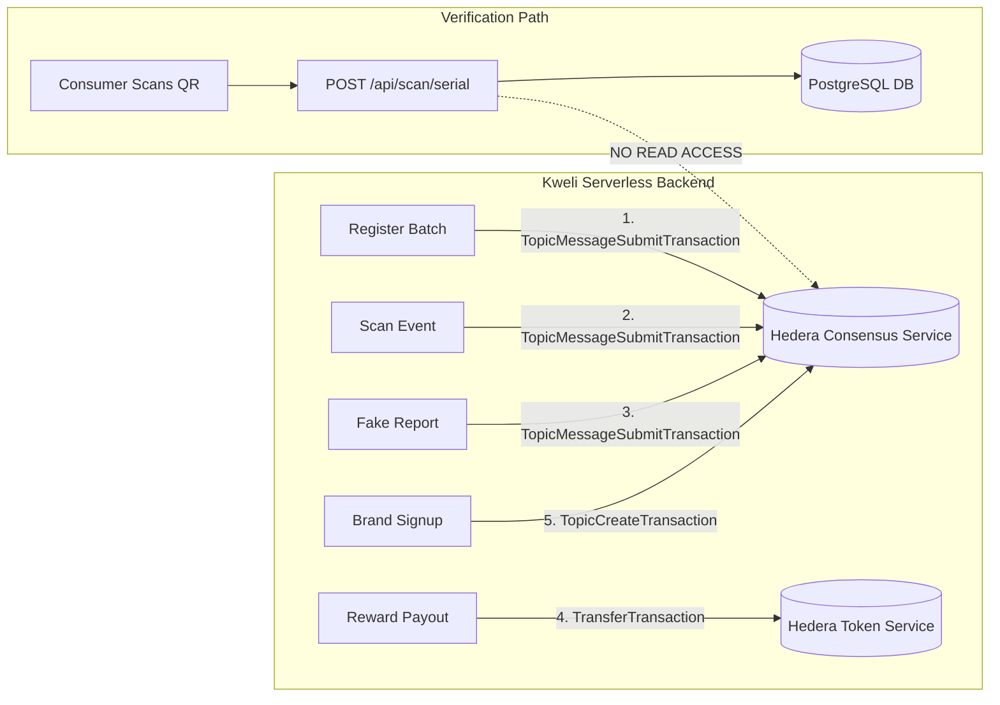
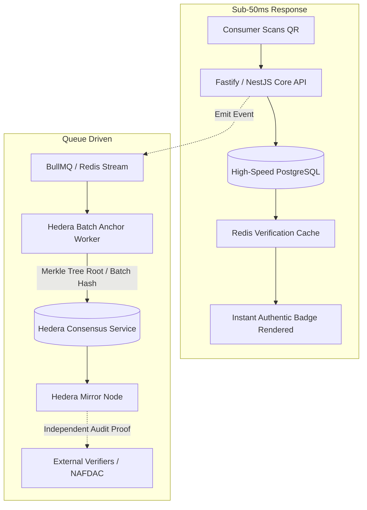

# KWELI — HEDERA AND INFRASTRUCTURE ASSESSMENT

**Document ID:** KW-AUDIT-09  
**Audit Date:** October 2026  
**Subject:** Hedera Hashgraph (HCS/HTS) Integration, Operating Costs, Latency Bottlenecks, and Infrastructure Scalability  

---

## 1. Executive Summary & Verdict on Hedera Integration

Kweli was entered into the *Hedera Africa Hackathon 2025* as a decentralized physical infrastructure network (DePIN) powered by Hedera Hashgraph.

> [!IMPORTANT]
> **The current implementation treats Hedera as a write-only, fire-and-forget logging sink.**  
> - **Product verification DOES NOT depend on Hedera.** Authenticity checks query internal PostgreSQL tables and never query Hedera consensus state.  
> - **Messages are never read back.** No code in the entire repository uses `TopicMessageQuery`, mirror node REST APIs, or gRPC mirror channels.  
> - **The HTS token contradicts documentation.** Created as an `Infinite` supply token named `KWL`, despite claims of a *"100M fixed supply of VFY"*.  
> - **Synchronous ledger calls in bulk imports cause serverless timeouts.**

**Core Recommendation:** **Make Hedera an optional, asynchronous anchoring layer rather than a synchronous dependency of the core verification workflow.**

---

## 2. Inventory of Current Hedera Ledger Interactions



### Detailed Interaction Audit

| Interaction | Triggering Code | Transaction Type | Data / Payload Submitted | Limitations & Observed Reality |
| :--- | :--- | :--- | :--- | :--- |
| **1. Company Topic Creation** | `api/auth/signup/route.js`, `lib/hedera/hcs.ts` (`createTopic`) | `TopicCreateTransaction` | Topic memo: `"Kweli Product Verification System"` | Creates a new HCS topic for every company. Submissions are signed by operator key. |
| **2. Batch Registration** | `api/products/register/route.js` (`submitProductToHedera`) | `TopicMessageSubmitTransaction` | JSON: `{ action: "REGISTER_PRODUCT", data: { name, batchSize, sku } }` | Only submits batch summary; **does not submit individual serial numbers**. If call fails, code swallows error. |
| **3. Verification Logging** | `api/scan/[serial]/route.js` (`submitVerificationToHedera`)| `TopicMessageSubmitTransaction` | JSON: `{ action: "VERIFY_PRODUCT", data: { serialCode, scanResult } }` | Fire-and-forget call; verification outcome is returned to consumer **before** Hedera receives the message. |
| **4. Fake Report Logging** | `api/products/report-fake/route.js` | `TopicMessageSubmitTransaction` | JSON: `{ action: "REPORT_FAKE", data: { reportId, productName } }` | Logs unvetted user text. Privacy risk: Logs user IP / location strings to public ledger. |
| **5. Token Transfer** | `api/transfer/route.js`, `lib/hedera/transferToken.ts` | `TransferTransaction` | Transfers `amount` of `HEDERA_TOKEN_ID` from operator to user account | **Critical security vulnerability:** Unauthenticated endpoint allows arbitrary draining of treasury tokens. |
| **6. Token Minting** | `api/mint/route.js`, `lib/hedera/mintToken.ts` | `TokenMintTransaction` | Mints `amount` of new tokens | Unauthenticated endpoint allows arbitrary minting. |

---

## 3. Cost, Throughput & Performance Analysis

### A. Transaction Costs (Hedera Testnet vs. Mainnet)

| Hedera Operation | Network Fee (USD) | 1,000 Units | 100,000 Units | 1,000,000 Units |
| :--- | :---: | :---: | :---: | :---: |
| **HCS Topic Creation** | \$0.01 per topic | \$0.01 (1 brand) | \$0.01 (1 brand) | \$0.01 (1 brand) |
| **HCS Batch Message** | \$0.0001 per message | \$0.0001 (1 batch) | \$0.01 (100 batches) | \$0.10 (1,000 batches) |
| **HCS Per-Unit Submission** | \$0.0001 per message | \$0.10 | \$10.00 | \$100.00 |
| **HTS Token Transfer** | \$0.001 per transfer | \$1.00 | \$100.00 | \$1,000.00 |

*Finding:* While Hedera consensus transactions are remarkably inexpensive (\$0.0001), **HTS token transfers cost 10x more (\$0.001)**. Transferring tokens to consumers on every single 5-token or 10-token scan would cost more in ledger gas fees than the economic value of the reward itself!

### B. Latency & Bottlenecks

- **Hedera Consensus Latency:** Hedera transactions require **2.5 to 4.0 seconds** to reach consensus and return a confirmed receipt.
- **Vercel Timeout Bottleneck:**
  - In `apps/web/app/api/products/csv-import/route.js`, the code executes a synchronous loop submitting messages one-by-one:
    ```javascript
    for (let i = 0; i < quantity; i++) {
      await submitProductToHedera(...);
    }
    ```
  - Submitting a batch of 100 items synchronously takes $100 \times 3\text{s} = 300\text{ seconds}$.
  - Vercel functions hard-terminate after 30 seconds (`maxDuration: 30` in `vercel.json`).
  - **Result:** Any bulk registration on Vercel is guaranteed to crash midway.

---

## 4. Privacy Risk: Writing Personal Data to a Public Ledger

In `apps/web/app/api/products/report-fake/route.js` lines 97-105:
```javascript
hederaResult = await submitProductToHedera({
  action: 'REPORT_FAKE',
  reportId: report.id,
  productName,
  brandName: brandName || 'Unknown',
  location: location || 'Not specified',
  reportedBy: userId || 'anonymous',
  timestamp: new Date().toISOString()
});
```
- Because Hedera topics are publicly readable on HashScan and mirror nodes, writing user locations (`location`) and reporter user IDs (`userId`) creates an **immutable, undeletable public record** of consumer telemetry.
- **GDPR / NDPA Violation:** Public blockchains do not support the Right to Erasure. Personal identifiers must **never** be written to public ledger messages.

---

## 5. Architectural Recommendation: Retain, Simplify, or Replace?

### Recommendation: **SIMPLIFY & MAKE OPTIONAL (Asynchronous Anchoring)**



### Strategic Reasons:

1. **Decouple User Scans from Ledger Latency:** The consumer verification page must load in under 200 milliseconds. It must never wait for blockchain consensus.
2. **Batch / Merkle Tree Anchoring:** Instead of submitting individual messages per item, combine 10,000 unit serial hashes into a single Merkle Tree root and publish **one** consensus message per production run (\$0.0001 per 10,000 units).
3. **Decouple Rewards into Off-Chain Points:** Accumulate rewards off-chain in PostgreSQL. Allow users to batch-withdraw their VFY tokens to Hedera or redeem them directly for airtime via an aggregator once a minimum threshold is reached.
4. **Read Verification from Mirror Nodes:** To make Hedera genuinely valuable, build a verification reader that validates batch Merkle roots against Hedera mirror nodes, providing true tamper-evident proof to customs and regulatory authorities.
