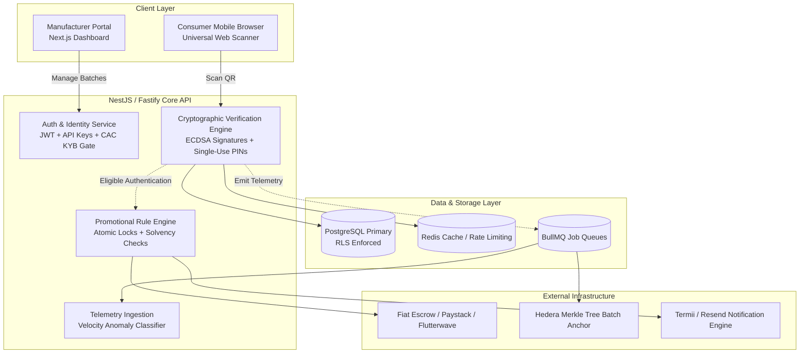

# KWELI — MVP RECOMMENDATIONS, ARCHITECTURAL ROADMAP, AND DECISION MATRIX

**Document ID:** KW-AUDIT-10  
**Audit Date:** October 2026  
**Subject:** Component Master Table, 30/60/90-Day Execution Roadmap, Pilot 1 Blueprint, and Executive Answers  

---

## 1. Master Subsystem Decision & Prioritization Matrix

The table below catalogs every major feature and subsystem, evaluating current health, strategic disposition, security risk, business value, and recommended next steps:

| Feature / Subsystem | Current State | Reuse Decision | Security Priority | Business Priority | Est. Effort | Dependencies | Recommended Next Action |
| :--- | :---: | :---: | :---: | :---: | :---: | :--- | :--- |
| **In-Browser Scanner UI** (`apps/web/scan/page.tsx`) | **Working** | **Keep** | Medium | **High** | 3 days | Backend scan API | Retain modern camera view; wire strictly to new verified API endpoint. |
| **Direct URL Landing** (`apps/web/v/[serial]`) | **Working** | **Refactor** | **Critical** | **High** | 5 days | Cryptographic signatures | Replace fake "checking signatures" claim with genuine cryptographic proof; add scratch-off PIN input. |
| **Next.js Backend API** (`apps/web/app/api`) | **Broken** | **REPLACE** | **Critical** | **Critical**| 3 weeks | PostgreSQL / Prisma | **Deprecate completely.** Unauthenticated transfer endpoints and BOLA leaks make this unfixable in-place. |
| **NestJS Backend Core** (`apps/api`) | **Partial** | **Refactor & Promote** | **Critical** | **Critical**| 2 weeks | Prisma / DB schema | Commit untracked files; reconcile schema; implement strict JWT & API key guards; deploy as primary API. |
| **Database Schema** | **Broken** | **Refactor** | **Critical** | **Critical**| 1 week | Supabase PostgreSQL | Re-enable RLS; fix column name mismatches (`scanned_at`, `won`); delete unencrypted private key columns. |
| **Hedera Consensus (HCS)** | **Partial** | **Simplify & Make Optional** | Medium | Medium | 1 week | BullMQ / Redis | Decouple from user request path; write Merkle tree batch roots asynchronously via background queue. |
| **Hedera Token Service (HTS)**| **Broken** | **Redesign** | **Critical** | Medium | 2 weeks | Treasury wallet | Delete `/api/transfer`; replace instant client payouts with off-chain internal points ledger. |
| **Consumer Mobile App** (`apps/mobile`) | **Broken** | **Postpone / Refactor** | High | Medium | 3 weeks | Backend API v1 | Defer mobile app for Pilot 1; fix `/products/scan` URL path bug; remove duplicate `.web.tsx` screens for Pilot 2. |
| **Manufacturer Portal UI** (`dashboard/products`) | **Partial** | **Refactor** | High | **High** | 1 week | NestJS API | Fix ID mismatch where selecting all products passes product IDs instead of unit IDs. |
| **Bulk CSV Import** | **Broken** | **Refactor** | High | **High** | 1 week | Background queue | Remove synchronous per-item Hedera loop; insert units in bulk chunks and anchor batch asynchronously. |
| **Instant-Win Campaigns** | **Broken** | **Refactor** | **Critical** | Medium | 2 weeks | Pre-funded escrow | Add database atomic locks (`current_winners < max_winners`); require pre-funded escrow before activation. |
| **AI Photo Verification** | **Flawed** | **RETIRE FROM AUTH** | **Critical** | Low | 2 days | None | Strip AI from authenticity certification; reassign as cosmetic packaging inspection / defect reporting. |
| **Counterfeit Reporting** | **Working** | **Refactor** | **Critical** | Medium | 3 days | Admin review queue | Halt immediate 5 VFY reward disbursement; require admin review before approving reward. |
| **Brand Analytics Dashboard**| **Broken** | **Refactor** | Medium | **High** | 1 week | Fixed DB columns | Fix `scanned_at` SQL error; introduce geographic velocity anomaly detection for genuine clone alerts. |
| **Developer API Keys** | **Missing** | **Build** | High | Medium | 1 week | NestJS Guard | Wire `kw_live_...` API keys into NestJS API guard; enforce rate limits and tenant boundaries. |

---

## 2. Explicit Executive Answers to Required Questions

### 1. What can we reuse without major changes?
- **The In-Browser Scanner UI (`apps/web/app/(public)/scan/page.tsx`):** The camera viewfinder, canvas frame capture (`jsQR`), manual entry modal, and UI animations are well-executed, responsive, and provide a frictionless consumer experience without requiring an app download.
- **Shared Configuration & Types (`packages/config`, `packages/shared-types`):** Clean TypeScript interfaces and network configuration that can continue to serve as the monorepo’s shared contract.
- **Brand Packaging Design Canvas (`components/QrPlacementCanvas.jsx`, `QrEmbedder.ts`):** The interactive coordinate placement tools and image embedding modules can be reused with minor refactoring.

### 2. What must be fixed before any pilot?
- **SEC-01 (Treasury Token Drain):** Delete or lock down `POST /api/transfer` and `POST /api/mint`.
- **SEC-02 (Database RLS):** Re-enable Row Level Security on all tables in Supabase.
- **SEC-04 (BOLA/IDOR Leaks):** Secure `GET /api/products/company/[id]` to prevent competitors or counterfeiters from harvesting genuine serial numbers.
- **DATA-01 (Database Column Mismatches):** Fix column discrepancies (`scanned_at` vs. `created_at`, `won` vs. `is_winner`) crashing the analytics dashboard and campaign engines.
- **CSV Import Timeouts:** Eliminate synchronous Hedera calls inside the import loop.
- **Brand Verification Gate (KYB):** Block self-serve product issuance until a business entity is vetted.

### 3. What must be redesigned before open-sourcing?
- **Protocol & Identifier Schema:** Shift from arbitrary UUID URLs to **GS1 Digital Link** standard format (`/01/{gtin}/21/{serial}`).
- **Decoupled Verification Engine:** Create `@kweli/verify` as a standalone npm package that performs cryptographic signature verification offline with **zero proprietary database dependencies**.
- **Cryptographic Signatures:** Replace static database lookups with verifiable asymmetric digital signatures (ECDSA/Ed25519) signed by the manufacturer's verified key.
- **Repository Scrubbing:** Clean Git commit history to ensure no local secrets, service keys, or operator credentials are leaked publicly.

### 4. What is the smallest end-to-end product we can safely launch (Pilot 1 MVP)?
The smallest safe product is a **Web-First Cryptographic Verification Pilot** focused on a single product line for 1–2 vetted manufacturers:
1. **Manufacturer Workflow:**
   - Vetted manufacturer registers 1 product line (e.g. 5,000 units).
   - Platform generates serialized GS1 Digital Link QR codes with asymmetric signatures.
   - Codes incorporate a physical break-seal or scratch-off latex PIN.
   - Manufacturer downloads print-ready packaging or label sheets.
2. **Consumer Workflow:**
   - Consumer scans QR code using standard phone camera (no app install required).
   - Browser opens direct verification page (`/v/{serial}`).
   - Web page validates brand identity and digital signature instantly (< 100ms).
   - Consumer scratches seal and inputs the 8-character PIN to activate/consume the item.
   - System confirms first-time activation; subsequent entries of the same PIN warn of reuse.
3. **Ledger Workflow:**
   - Batch Merkle tree root is anchored asynchronously to Hedera Consensus Service.

---

### 5. What is the recommended architecture for authentication, campaigns, rewards, and analytics?



- **Authentication:** Dual-layer physical-digital verification (Public outer GS1 QR + Hidden scratch-off PIN). Zero reliance on unscientific AI photo aesthetics.
- **Campaigns & Rewards:** Decoupled promotional engine. Pre-funded escrow required before campaign launch. Atomic database locks on prize allocations. Off-chain reward points with bulk withdrawal thresholds.
- **Analytics:** Event pipeline classifying observed telemetry into genuine repeat consumer scans vs. geographic velocity anomalies (actual cloning indicators).

---

### 6. Should Hedera remain, become optional, or be removed?
- **Verdict: RETAIN, BUT MAKE ASYNCHRONOUS AND OPTIONAL.**
- **Why Retain:** Hedera provides an auditable, timestamped public consensus trail that establishes independent trust for regulatory bodies (such as NAFDAC), international supply chain auditors, and customs officials without exposing Kweli's database.
- **How to Fix:**
  - Remove Hedera calls from consumer HTTP verification requests. Verification must be sub-100ms and operate even if Hedera is offline.
  - Publish **batch Merkle tree roots** to HCS rather than individual serial messages, cutting operating costs by 99.9% (\$0.0001 per 10,000 units).
  - Treat HTS tokens as an optional withdrawal destination for off-chain loyalty points.

---

### 7. What should be built in the first 30 days?

```
Weeks 1 - 2: Triage, Security Hardening & Backend Consolidation
  ├── Delete /api/transfer, /api/mint, and /api/associate in apps/web.
  ├── Re-enable Supabase RLS and delete plaintext private key columns.
  ├── Commit apps/api to git; establish as primary NestJS REST backend.
  └── Reconcile database schema; fix scanned_at and campaign column bugs.

Weeks 3 - 4: Core Pilot Verification Engine
  ├── Implement asymmetric key generation for brands (ECDSA secp256k1).
  ├── Implement dual-layer identifier generator (GS1 QR + 8-char scratch PIN).
  ├── Wire apps/web/scan/page.tsx to NestJS verification endpoint.
  ├── Build BullMQ asynchronous worker to anchor batch Merkle roots to Hedera HCS.
  └── Deploy automated test suite covering authentication, duplicate detection, and BOLA.
```

---

### 8. What additional information is required before making a confident decision?

Before committing capital to the commercial pilot, the executive team must obtain:
1. **Target Manufacturer Packaging Constraints:** Can the pilot brand support tamper-evident labels, scratch-off coatings, or blister-pack printing lines? What is their packaging cost tolerance per unit (\$0.005 vs. \$0.02)?
2. **Regulatory Positioning (NAFDAC / Authorities):** What specific audit trail and serialization standards (e.g. GS1 DataMatrix vs. QR) do regulatory bodies in the target jurisdiction mandate?
3. **Reward Funding Model:** Is the pilot brand funding instant-win cash/airtime promotions directly, or is Kweli funding $VFY token incentives from platform reserves?
4. **Production Hosting Environment:** Confirmation of target infrastructure (e.g. AWS ECS / DigitalOcean Kubernetes for the NestJS API vs. continued Vercel serverless usage).
