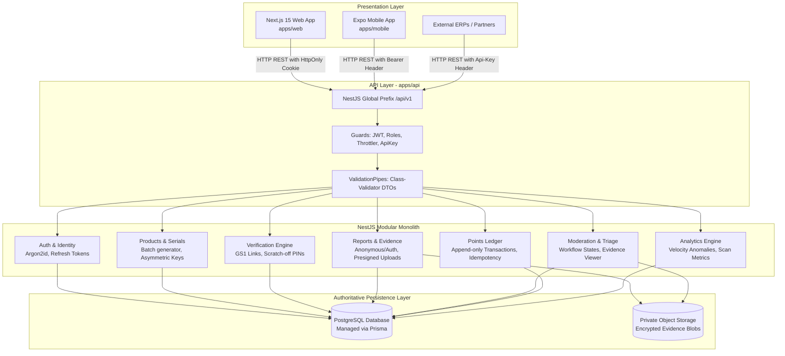
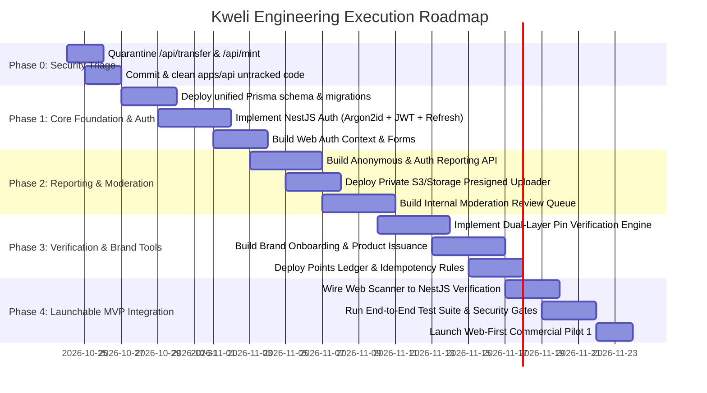

# KWELI — ARCHITECTURE, SYSTEM DESIGN & REBUILD ROADMAP

**Document Version:** 1.0.0  
**Status:** Approved Architectural Baseline  
**Date:** October 2026  
**Codename:** Kweli (Brand rename decoupled and scheduled)  

---

## 1. Locked Architectural Decisions

| Area | Decision | Rationale |
| :--- | :--- | :--- |
| **Monorepo Structure** | Single `pnpm` monorepo orchestrated with Turborepo | Keeps API, web, contracts, and future mobile app in sync without multi-repo friction. |
| **Frontend Layer** | Next.js 15 App Router (`apps/web`) — **Presentation Only** | Strictly owns UI components, user navigation, client-side validation, and state. **Zero direct database connections, zero Next.js API route handlers, zero business logic.** |
| **Application / API Layer** | Dedicated NestJS 11 REST API (`apps/api`) | Modular monolith with OpenAPI Swagger docs, class-validator DTOs, global throttlers, and enterprise-grade exception filters. Owns all business logic, verification, reports, points, and permissions. |
| **Data Store** | Managed PostgreSQL (Supabase / Self-hosted Postgres) | Authoritative source of truth. Version-controlled schema migrations managed via Prisma ORM / SQL migrations. Strict foreign keys, check constraints, and composite unique indexes. |
| **Authentication & Identity** | In-House JWT Auth inside NestJS + Argon2id | Does not rely on Supabase Auth. Short-lived JWT access tokens (15 mins), rotating revocable refresh tokens stored in DB and delivered via `HttpOnly`, `Secure` cookies. Passwords hashed with **Argon2id**. |
| **Database Access & Security** | Restricted Postgres App Role + NestJS Object Guards | NestJS connects to PostgreSQL using a dedicated application role (not superuser/service-role bypass). Object-level authorization enforced on every endpoint by ID. |
| **Brand Identity** | Keep "Kweli" as internal namespace; decouple brand strings | All public-facing names, URLs, and logos are centralized in `@kweli/config` so a future trademark/brand rename requires zero schema or code refactoring. |
| **Incentive Model** | **Internal Points Ledger Now; Blockchain Tokens Later** | Immediate retirement of `/api/transfer` and `/api/mint`. Points are managed via an auditable, append-only double-entry style `points_ledger` table with strict idempotency and anti-abuse caps. |
| **Product Verification** | Dual-Layer Physical & Cryptographic Authentication | Replaces pure static UUID database lookup. Public GS1 Digital Link outer QR + single-use hidden scratch-off PIN. Cryptographic signature check (ECDSA secp256k1). Zero reliance on aesthetic AI heuristics. |
| **Reporting System** | Unified Endpoint for Anonymous and Authenticated Submissions | Common report pipeline. Anonymous reporters get an unguessable access key to check progress; authenticated reporters track submissions in their profile and earn reviewed points. |

---

## 2. Monorepo Repository Structure

```
kweli/
├── apps/
│   ├── api/                          # Dedicated NestJS REST API
│   │   ├── prisma/                   # Prisma schema & migrations
│   │   │   ├── migrations/
│   │   │   └── schema.prisma
│   │   ├── src/
│   │   │   ├── common/               # Guards, interceptors, decorators, filters
│   │   │   │   ├── decorators/       # @CurrentUser(), @Public(), @Roles()
│   │   │   │   ├── filters/          # HttpExceptionFilter
│   │   │   │   ├── guards/           # JwtAuthGuard, RolesGuard, ApiKeyGuard
│   │   │   │   └── interceptors/     # Transform, Logging, Idempotency
│   │   │   ├── core/                 # Shared infrastructure adapters
│   │   │   │   ├── database/         # PrismaService
│   │   │   │   ├── storage/          # S3 / Supabase Private Storage Adapter
│   │   │   │   └── notifications/    # Email (Resend) & SMS (Termii)
│   │   │   ├── modules/              # Logical domain modules
│   │   │   │   ├── auth/             # Login, signup, refresh, passwords (Argon2id)
│   │   │   │   ├── users/            # User profiles & account preferences
│   │   │   │   ├── organizations/    # Companies, brands, memberships, KYB state
│   │   │   │   ├── products/         # Products, batches, serialized units
│   │   │   │   ├── verification/     # Cryptographic validation & scratch-off PINs
│   │   │   │   ├── reports/          # Anonymous & authenticated counterfeit reports
│   │   │   │   ├── moderation/       # Reviewer investigation dashboard & evidence
│   │   │   │   ├── points/           # Auditable points ledger & reward rules
│   │   │   │   ├── campaigns/        # Instant-win promotions & escrow bounds
│   │   │   │   └── analytics/        # Verified scan stats & velocity anomaly alerts
│   │   │   ├── app.module.ts
│   │   │   └── main.ts
│   │   ├── test/                     # Unit, integration, and e2e test suites
│   │   ├── package.json
│   │   └── tsconfig.json
│   │
│   ├── web/                          # Next.js 15 Frontend (Presentation Only)
│   │   ├── app/                      # App router: Pages, Layouts, Client Views
│   │   │   ├── (public)/             # Landing (/), Scanner (/scan), Report (/report)
│   │   │   ├── (auth)/               # Login (/login), Register (/register)
│   │   │   ├── (consumer)/           # My Profile (/account), My Reports (/account/reports)
│   │   │   ├── (portal)/             # Manufacturer Dashboard (/dashboard/*)
│   │   │   └── (admin)/              # Staff Moderation Queue (/admin/*)
│   │   ├── components/               # UI components, camera viewfinder, modals
│   │   ├── lib/
│   │   │   ├── api-client.ts         # Strictly typed SDK calling NestJS API
│   │   │   └── auth-context.tsx      # React Context for consumer/brand auth state
│   │   ├── public/                   # Static assets, fonts, icons
│   │   ├── package.json
│   │   └── next.config.mjs
│   │
│   ├── mobile/                       # Expo / React Native App (Deferred to Phase 4)
│   │   ├── app/                      # Expo Router screens
│   │   ├── package.json
│   │   └── app.json
│   │
│   └── worker/                       # Background Queue Worker (When needed)
│       ├── src/                      # BullMQ processors (batch jobs, ledger anchoring)
│       └── package.json
│
├── packages/
│   ├── config/                       # Shared branding, environment keys, rewards config
│   │   └── src/index.ts
│   ├── shared-types/                 # Shared TypeScript interfaces & DTO contracts
│   │   └── src/index.ts
│   └── protocol/                     # Future GS1 & W3C VC serialization schemas
│       └── src/index.ts
│
├── .gitignore
├── package.json                      # Monorepo root workspace scripts
├── pnpm-lock.yaml
├── pnpm-workspace.yaml
├── README.md
└── turbo.json
```

---

## 3. Application & Service Layer Boundaries



### Strict Boundary Rules:
1. **Zero Database in Next.js:** The file tree `apps/web/app/api` will be deleted. Next.js functions strictly as an HTTP client calling `http://localhost:4000/api/v1` (dev) or `https://api.kweli.app/v1` (prod).
2. **NestJS Does Not Serve HTML:** The API returns strictly `application/json` responses.
3. **No Direct Inter-Module Table Mutations:** If the `ReportsModule` wants to award points, it calls `PointsService.awardPoints(...)` via its public interface; it never writes directly to `points_ledger`.

---

## 4. Authoritative PostgreSQL Data Model (Prisma Schema)

```prisma
datasource db {
  provider = "postgresql"
  url      = env("DATABASE_URL")
}

generator client {
  provider = "prisma-client-js"
}

// ==========================================================
// 1. IDENTITY, ORGANIZATIONS & ACCESS
// ==========================================================

enum UserRole {
  CONSUMER
  BRAND_STAFF
  BRAND_ADMIN
  MODERATOR
  SYSTEM_ADMIN
}

enum KybStatus {
  UNVERIFIED
  PENDING_REVIEW
  VERIFIED
  SUSPENDED
  REJECTED
}

model User {
  id               String           @id @default(uuid()) @db.Uuid
  email            String           @unique @db.VarChar(255)
  passwordHash     String           @map("password_hash") @db.VarChar(255)
  firstName        String?          @map("first_name") @db.VarChar(100)
  lastName         String?          @map("last_name") @db.VarChar(100)
  phone            String?          @db.VarChar(50)
  role             UserRole         @default(CONSUMER)
  isEmailVerified  Boolean          @default(false) @map("is_email_verified")
  createdAt        DateTime         @default(now()) @map("created_at")
  updatedAt        DateTime         @updatedAt @map("updated_at")

  refreshSessions  RefreshSession[]
  memberships      OrganizationMember[]
  reports          Report[]
  pointAccount     PointAccount?

  @@map("users")
}

model RefreshSession {
  id           String    @id @default(uuid()) @db.Uuid
  userId       String    @map("user_id") @db.Uuid
  tokenHash    String    @map("token_hash") @db.VarChar(255)
  userAgent    String?   @map("user_agent") @db.Text
  ipAddress    String?   @map("ip_address") @db.VarChar(45)
  isRevoked    Boolean   @default(false) @map("is_revoked")
  expiresAt    DateTime  @map("expires_at")
  createdAt    DateTime  @default(now()) @map("created_at")

  user         User      @relation(fields: [userId], references: [id], onDelete: Cascade)

  @@index([userId])
  @@index([tokenHash])
  @@map("refresh_sessions")
}

model Organization {
  id               String               @id @default(uuid()) @db.Uuid
  legalName        String               @map("legal_name") @db.VarChar(255)
  tradingName      String?              @map("trading_name") @db.VarChar(255)
  registrationNum  String?              @unique @map("registration_num") @db.VarChar(100)
  kybStatus        KybStatus            @default(UNVERIFIED) @map("kyb_status")
  websiteUrl       String?              @map("website_url") @db.VarChar(255)
  createdAt        DateTime             @default(now()) @map("created_at")
  updatedAt        DateTime             @updatedAt @map("updated_at")

  members          OrganizationMember[]
  brands           Brand[]
  apiKeys          ApiKey[]

  @@map("organizations")
}

model OrganizationMember {
  id             String       @id @default(uuid()) @db.Uuid
  organizationId String       @map("organization_id") @db.Uuid
  userId         String       @map("user_id") @db.Uuid
  role           UserRole     @default(BRAND_STAFF)
  createdAt      DateTime     @default(now()) @map("created_at")

  organization   Organization @relation(fields: [organizationId], references: [id], onDelete: Cascade)
  user           User         @relation(fields: [userId], references: [id], onDelete: Cascade)

  @@unique([organizationId, userId])
  @@map("organization_members")
}

model ApiKey {
  id             String       @id @default(uuid()) @db.Uuid
  organizationId String       @map("organization_id") @db.Uuid
  keyPrefix      String       @map("key_prefix") @db.VarChar(12) // kw_live_...
  keyHash        String       @unique @map("key_hash") @db.VarChar(255)
  name           String       @db.VarChar(100)
  isRevoked      Boolean      @default(false) @map("is_revoked")
  lastUsedAt     DateTime?    @map("last_used_at")
  createdAt      DateTime     @default(now()) @map("created_at")

  organization   Organization @relation(fields: [organizationId], references: [id], onDelete: Cascade)

  @@map("api_keys")
}

// ==========================================================
// 2. PRODUCT REGISTRY & IDENTIFIERS
// ==========================================================

model Brand {
  id             String       @id @default(uuid()) @db.Uuid
  organizationId String       @map("organization_id") @db.Uuid
  name           String       @db.VarChar(255)
  logoUrl        String?      @map("logo_url") @db.Text
  createdAt      DateTime     @default(now()) @map("created_at")

  organization   Organization @relation(fields: [organizationId], references: [id], onDelete: Cascade)
  products       Product[]

  @@map("brands")
}

model Product {
  id             String          @id @default(uuid()) @db.Uuid
  brandId        String          @map("brand_id") @db.Uuid
  name           String          @db.VarChar(255)
  gtin           String?         @db.VarChar(14)
  sku            String?         @db.VarChar(100)
  category       String?         @db.VarChar(100)
  description    String?         @db.Text
  createdAt      DateTime        @default(now()) @map("created_at")
  updatedAt      DateTime        @updatedAt @map("updated_at")

  brand          Brand           @relation(fields: [brandId], references: [id], onDelete: Cascade)
  batches        ProductBatch[]

  @@unique([brandId, sku])
  @@map("products")
}

model ProductBatch {
  id             String          @id @default(uuid()) @db.Uuid
  productId      String          @map("product_id") @db.Uuid
  batchNumber    String          @map("batch_number") @db.VarChar(100)
  mfgDate        DateTime?       @map("mfg_date")
  expDate        DateTime?       @map("exp_date")
  batchSize      Int             @map("batch_size")
  isRecalled     Boolean         @default(false) @map("is_recalled")
  createdAt      DateTime        @default(now()) @map("created_at")

  product        Product         @relation(fields: [productId], references: [id], onDelete: Cascade)
  units          ProductUnit[]

  @@unique([productId, batchNumber])
  @@map("product_batches")
}

enum UnitStatus {
  ISSUED
  ACTIVATED
  FLAGGED_SUSPICIOUS
  RECALLED
}

model ProductUnit {
  id             String          @id @default(uuid()) @db.Uuid
  batchId        String          @map("batch_id") @db.Uuid
  publicSerial   String          @unique @map("public_serial") @db.VarChar(64)
  scratchPinHash String          @map("scratch_pin_hash") @db.VarChar(255) // Argon2id or HMAC
  status         UnitStatus      @default(ISSUED)
  scanCount      Int             @default(0) @map("scan_count")
  firstScannedAt DateTime?       @map("first_scanned_at")
  createdAt      DateTime        @default(now()) @map("created_at")

  batch          ProductBatch    @relation(fields: [batchId], references: [id], onDelete: Cascade)
  scanEvents     ScanEvent[]
  reports        Report[]

  @@index([publicSerial])
  @@map("product_units")
}

// ==========================================================
// 3. VERIFICATION & TELEMETRY
// ==========================================================

enum VerificationOutcome {
  AUTHENTIC_FIRST_SCAN
  AUTHENTIC_ACTIVATED
  ALREADY_ACTIVATED_WARNING
  SUSPICIOUS_REPETITION
  INVALID_OR_UNKNOWN_CODE
  PRODUCT_RECALLED
}

model ScanEvent {
  id             String              @id @default(uuid()) @db.Uuid
  unitId         String?             @map("unit_id") @db.Uuid
  rawCodeInput   String?             @map("raw_code_input") @db.VarChar(255)
  outcome        VerificationOutcome
  maskedIp       String?             @map("masked_ip") @db.VarChar(45)
  userAgent      String?             @map("user_agent") @db.Text
  city           String?             @db.VarChar(100)
  country        String?             @db.VarChar(10)
  createdAt      DateTime            @default(now()) @map("created_at")

  unit           ProductUnit?        @relation(fields: [unitId], references: [id], onDelete: SetNull)

  @@index([unitId])
  @@index([createdAt(sort: Desc)])
  @@map("scan_events")
}

// ==========================================================
// 4. COUNTERFEIT REPORTING & EVIDENCE
// ==========================================================

enum ReportStatus {
  RECEIVED
  TRIAGE
  UNDER_INVESTIGATION
  SUBSTANTIATED
  INCONCLUSIVE
  DISMISSED
}

enum ReportSubmissionMode {
  ANONYMOUS
  AUTHENTICATED
}

model Report {
  id             String               @id @default(uuid()) @db.Uuid
  reportRef      String               @unique @map("report_ref") @db.VarChar(32) // KW-2026-XXXXX
  accessSecret   String               @map("access_secret") @db.VarChar(64) // For anonymous status check
  userId         String?              @map("user_id") @db.Uuid
  unitId         String?              @map("unit_id") @db.Uuid
  productName    String               @map("product_name") @db.VarChar(255)
  brandName      String?              @map("brand_name") @db.VarChar(255)
  description    String               @db.Text
  purchaseLocation String?            @map("purchase_location") @db.VarChar(255)
  mode           ReportSubmissionMode @default(ANONYMOUS)
  status         ReportStatus         @default(RECEIVED)
  moderatorNotes String?              @map("moderator_notes") @db.Text
  pointsAwarded  Boolean              @default(false) @map("points_awarded")
  createdAt      DateTime             @default(now()) @map("created_at")
  updatedAt      DateTime             @updatedAt @map("updated_at")

  user           User?                @relation(fields: [userId], references: [id], onDelete: SetNull)
  unit           ProductUnit?         @relation(fields: [unitId], references: [id], onDelete: SetNull)
  evidence       ReportEvidence[]
  pointsEntries  PointLedgerEntry[]

  @@index([reportRef])
  @@index([userId])
  @@index([status])
  @@map("reports")
}

model ReportEvidence {
  id             String       @id @default(uuid()) @db.Uuid
  reportId       String       @map("report_id") @db.Uuid
  storagePath    String       @map("storage_path") @db.VarChar(500)
  mimeType       String       @map("mime_type") @db.VarChar(100)
  fileSize       Int          @map("file_size")
  createdAt      DateTime     @default(now()) @map("created_at")

  report         Report       @relation(fields: [reportId], references: [id], onDelete: Cascade)

  @@map("report_evidence")
}

// ==========================================================
// 5. AUDITABLE POINTS LEDGER (NO TOKENS NOW)
// ==========================================================

enum PointTransactionType {
  REPORT_SUBMITTED_CREDIT
  REPORT_SUBSTANTIATED_BONUS
  MANUAL_ADMIN_ADJUSTMENT
  AWARD_REVERSAL_FRAUD
  REDEMPTION_AIRTIME_CLAIM
}

model PointAccount {
  id             String             @id @default(uuid()) @db.Uuid
  userId         String             @unique @map("user_id") @db.Uuid
  balance        Int                @default(0)
  lifetimeEarned Int                @default(0) @map("lifetime_earned")
  createdAt      DateTime           @default(now()) @map("created_at")
  updatedAt      DateTime           @updatedAt @map("updated_at")

  user           User               @relation(fields: [userId], references: [id], onDelete: Cascade)
  entries        PointLedgerEntry[]

  @@map("point_accounts")
}

model PointLedgerEntry {
  id             String               @id @default(uuid()) @db.Uuid
  accountId      String               @map("account_id") @db.Uuid
  reportId       String?              @map("report_id") @db.Uuid
  idempotencyKey String               @unique @map("idempotency_key") @db.VarChar(255)
  type           PointTransactionType
  amount         Int                  // Positive for credit, negative for debit
  balanceAfter   Int                  @map("balance_after")
  reason         String               @db.VarChar(255)
  createdAt      DateTime             @default(now()) @map("created_at")

  account        PointAccount         @relation(fields: [accountId], references: [id], onDelete: Cascade)
  report         Report?              @relation(fields: [reportId], references: [id], onDelete: SetNull)

  @@index([accountId])
  @@index([idempotencyKey])
  @@map("point_ledger_entries")
}
```

---

## 5. Execution Roadmap: 4-Phase Delivery Plan



### Phase 0: Immediate Security Containment (Days 1–2)
- **Goal:** Neutralize all high-severity threats identified in the audit.
- **Actions:**
  1. Delete `apps/web/app/api/transfer` and `apps/web/app/api/mint`.
  2. Remove mock verify dummy bypass in `FlutterwaveProvider.ts`.
  3. Commit untracked `apps/api` work to a clean development branch.
  4. Fix root `pnpm-workspace.yaml` and scripts to wire `apps/api`.

### Phase 1: Core API & Auth Foundation (Days 3–9)
- **Goal:** Establish the NestJS modular backend as the single authority with custom JWT auth.
- **Actions:**
  1. Initialize the consolidated Prisma schema in `apps/api/prisma/schema.prisma`.
  2. Implement `AuthModule` in NestJS:
     - User signup/login with **Argon2id**.
     - Short-lived JWT (15m) + revolving Refresh Tokens in PostgreSQL.
     - `JwtAuthGuard`, `RolesGuard`, and `@CurrentUser()` decorators.
  3. Create frontend API client in `apps/web/lib/api-client.ts` to consume NestJS auth.
  4. Write automated integration tests for token expiration, revocation, and role enforcement.

### Phase 2: Reporting System & Moderation Queue (Days 10–16)
- **Goal:** Deliver an end-to-end counterfeit reporting system with private evidence.
- **Actions:**
  1. Implement `ReportsModule`:
     - `POST /api/v1/reports` (supports both anonymous and authenticated submissions).
     - Generates unguessable reference (`KW-2026-XXXXX`) and secret key for status checking.
     - Generates presigned S3/Supabase upload URLs for private images.
  2. Implement `ModerationModule`:
     - Protected staff queue (`GET /api/v1/moderation/reports`).
     - State machine transition endpoints (`triage` -> `under_investigation` -> `substantiated`).
  3. Build the Next.js Public Report Page and Admin Review Queue.

### Phase 3: Cryptographic Verification & Points Ledger (Days 17–23)
- **Goal:** Implement the trustworthy dual-layer verification engine and point rewards.
- **Actions:**
  1. Implement `VerificationModule`:
     - GS1 link resolution and ECDSA signature check.
     - Scratch-off single-use activation PIN check.
     - Logs `ScanEvent` with IP anonymization (CIDR mask).
  2. Implement `PointsModule`:
     - Double-entry ledger (`PointAccount` & `PointLedgerEntry`).
     - Idempotency key protection on all awards.
     - Award points strictly on moderated/substantiated report transitions.
  3. Implement `ProductsModule`:
     - Batch creation and serialized unit generator.
     - Asynchronous CSV chunking.

### Phase 4: Integration, Hardening & Launch (Days 24–30)
- **Goal:** Connect Next.js presentation layer to NestJS API and pass all release gates.
- **Actions:**
  1. Re-wire `apps/web/app/(public)/scan/page.tsx` to call `POST /api/v1/verification/verify`.
  2. Implement consumer account dashboard (My Reports, My Points).
  3. Deploy automated end-to-end test suite (Jest + Playwright).
  4. Verify all 14 launch gates before opening Pilot 1 to brands and consumers.
